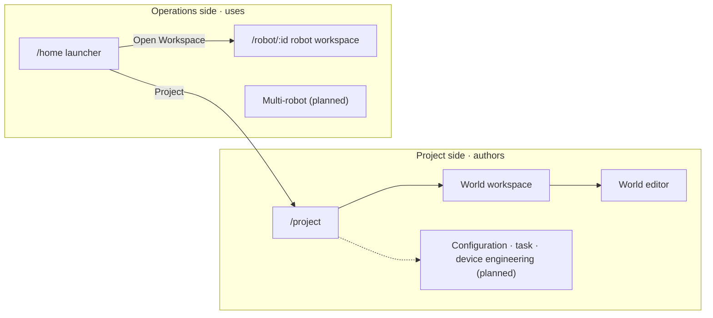
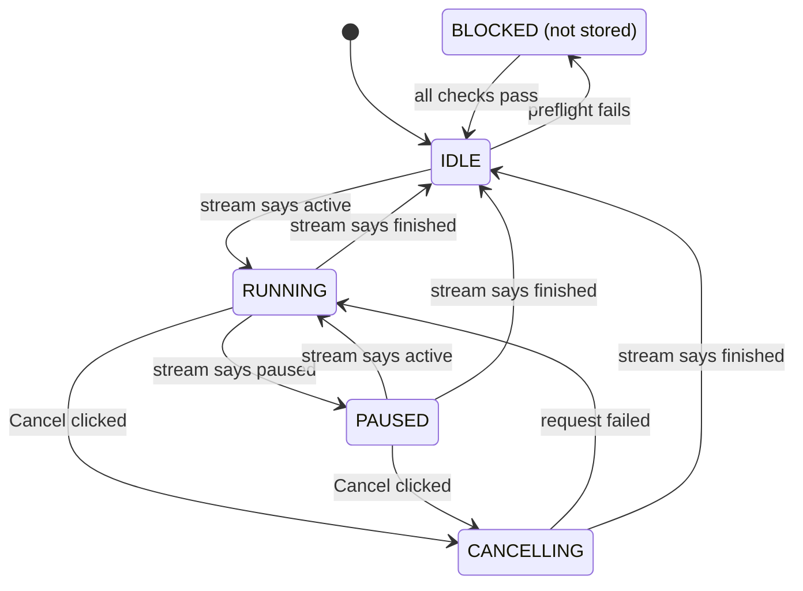
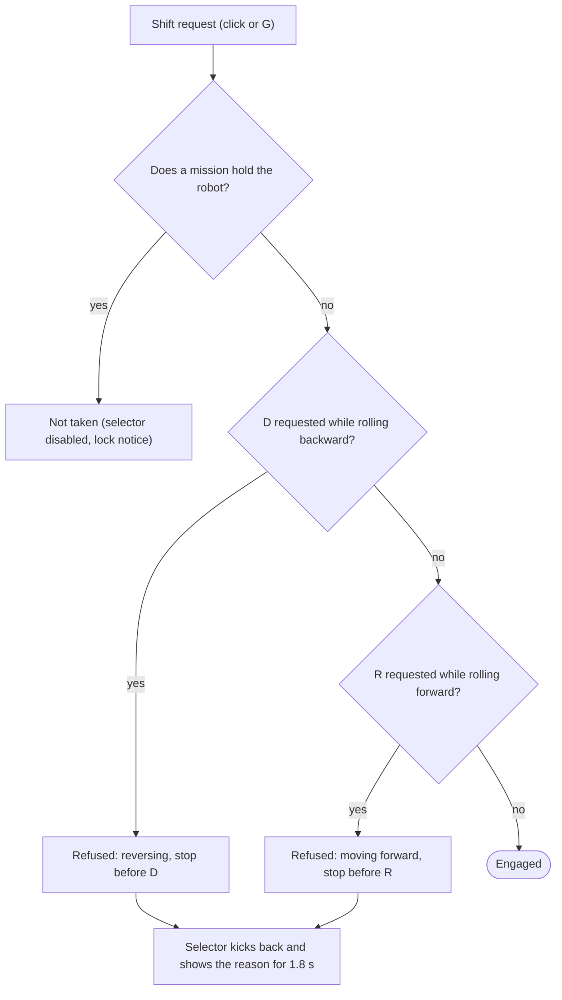
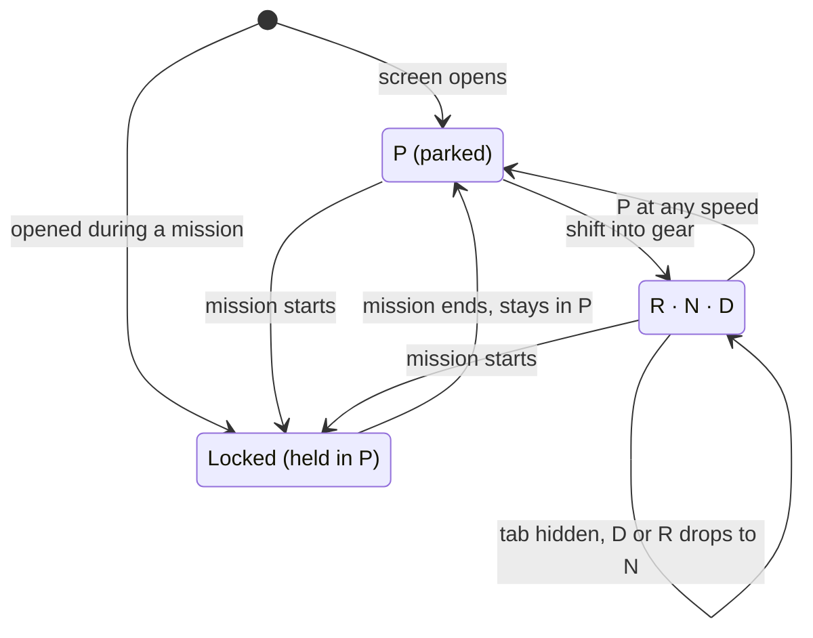
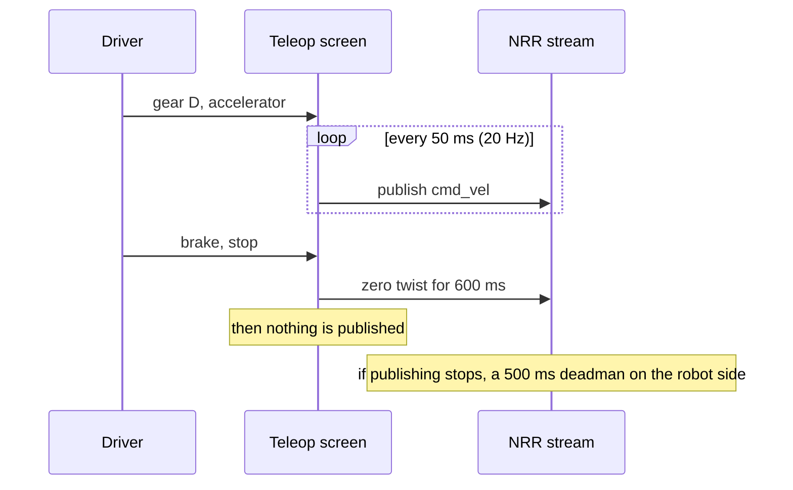
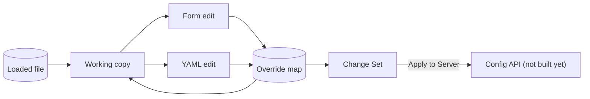

RES's screens are an instrument panel for several robots: small type, dense panels, and a frame closer to a drawing than to a card. This page covers the rules the screens follow, the tokens they are drawn with, and what each screen holds, where, and how it behaves.

Everything here is taken from the code of `@res/app` 0.19.1. Where the older planning documents disagree with the code, the code wins.

## Design principles

These are rules written down in code comments and design notes, and kept. Each ends with where it lives.

1. **Empty looks empty.** Nothing made up passes for real data. With no robots registered, the launcher shows "No robots", a short Korean note and a register button. A robot with no pose is not drawn. The 2D map hides a layer that has no data rather than filling it with made-up geometry. The world editor's one synthetic map has to be opened on purpose and wears a DEMO chip, and the Config fixtures are marked STUB. — `HomePage.tsx`, `demoMap.ts`, dashboard screen definition §4
2. **Unknown is not a pass.** Preflight checks have three values: ok, fail and unknown. Unknown is amber, fail is red, and an unconfirmed check such as localization keeps Start disabled. Unknown values show `—`, and an unknown progress bar is hatched rather than drawn at 0%. One exception: when the robot side publishes no e-stop state at all, the check shows `N/A` but does not block, because blocking would refuse every drive forever. — `dashboardStore.ts`, dashboard screen definition §3
3. **The most dangerous failure can wear the greenest colours.** A robot card is judged in this order: identity conflict, then the server's health probe, then the stream socket. An NRR that claims to be a different robot answers perfectly healthily while writing into someone else's history, so Conflict covers the green. A dead socket beside a live health probe is a lost stream, not a dead robot, and it gets its own amber No Stream. — `fleetModel.ts`
4. **Planned screens show their definition only.** A workspace that is not built yet opens a page stating what it will own, never a mock tool. A control that cannot be used is worse than an absent one. — `workspaces.ts`, `PlannedWorkspacePage.tsx`
5. **Only controls for what is drawn.** The Route & Task screen draws no robot, so it drops the centre-on-robot, follow-robot and robot-up buttons and forces follow off. — route screen definition §1
6. **A screen opens in the state its job needs.** Teleop opens live but parked in P, and its 3D view opens behind the robot, because a driver looks where the robot is going. Statistics opens in Charts, which shows the distributions first. — `TeleopPage.tsx`, `useViewMode.ts`
7. **Physical controls behave physically.** The gear selector moves rather than repaints: the stick slides along its gate, the dial turns, and a refused shift kicks back. Pedals have bite and travel time, and arrow-key steering stops once at the centre. The wheel, pedals and cluster are dark in both themes; a beige wheel in the light theme would be a different car. — `GearSelector.tsx`, `teleopModel.ts`, `SteeringCockpit.tsx`
8. **When autonomy holds the robot, manual control locks and says why.** While a mission is RUNNING, PAUSED or CANCELLING, teleop parks in P, locks, and shows the reason. When the mission ends it stays in P: control is offered back, never thrust back. The Config screen likewise shows a Locked banner with a link to whatever holds the configuration. — `useTeleopController.ts`, `ConfigWorkspace.tsx`
9. **SLAM maps look the way RViz draws them.** Map colours carry ROS meaning, not taste. The 2D and 3D canvases stay dark in both themes, and their constants are copied from RViz's Nav2 defaults. — `tokens.css`, `rvizNavigation2ViewConfig.ts`
10. **No explanatory sentences in finished UI.** Explanations belong in `HoverHint`, which opens at once on hover or focus. Native `title` is kept for the short names of icon buttons, because it opens late, in tiny type, and cannot be styled (a few spots on the dashboard, the launcher, History and Config still carry a sentence in `title`). Verdicts are the exception: attention rows, preflight reasons and lock reasons are full sentences in Korean, while labels are English. — GUI doc 07 §4, launcher design brief
11. **Accessibility is measured.** Measured contrast ratios sit in comments next to the tokens. The muted colour used for 9–11px text was raised until it cleared WCAG AA 4.5:1. `prefers-reduced-motion` is honoured, and icon-only buttons carry an `aria-label`. — `tokens.css`, GUI doc 07 §3
12. **Performance never costs the UX.** Nothing that has not changed is redrawn: the 2D map draws one frame on request, and the 3D view uses `frameloop="demand"`. Device pixel ratio is capped at 1.5. Stream data is batched into the stores every 50 ms or 250 ms, and pose easing smooths the steps that batching leaves. — GUI doc 06 §4

## Colour and tokens

Every colour the chrome draws (panels, text, badges, buttons, tables, dialogs) comes from a role token defined twice, once per theme. Chrome rules in the global stylesheet do not name a colour directly: one literal left in a panel is a colour that cannot follow the theme. The literals the stylesheet does hold are for things meant to look the same in both themes: the canvases and the overlays floating on them, legends, the teleop hardware, shadows and modal backdrops.

- The light values are the base set. A fresh install is on System, which leaves `<html data-theme>` empty and follows the OS; Light and Dark set it explicitly. The toggle has three buttons: Light, Dark and System.
- Canvas and data colours do not change with the theme.

### Surfaces

| Token | Light | Dark | Use |
|---|---|---|---|
| `--app-bg` | &nbsp;`#eef1f5` | &nbsp;`#07111c` | Page |
| `--header-bg` | &nbsp;`#ffffff` | &nbsp;`#09131f` | Header |
| `--rail-bg` | &nbsp;`#f7f9fb` | &nbsp;`#0a1420` | Navigation rail |
| `--panel-bg` | &nbsp;`#ffffff` | &nbsp;`#0d1824` | Panel |
| `--panel-bg-elevated` | &nbsp;`#ffffff` | &nbsp;`#111d2a` | Raised panel |
| `--panel-header-bg` | &nbsp;`#fbfcfd` | &nbsp;`#0c1722` | Panel header |
| `--inset-bg` | &nbsp;`#f2f5f8` | &nbsp;`#08121b` | Inset well |
| `--hover-bg` | &nbsp;`#f4f7fa` | &nbsp;`#111d2a` | Hover |
| `--overlay-bg` | &nbsp;`rgb(255 255 255 / 94%)` | &nbsp;`rgb(9 21 32 / 94%)` | Floating sheet |
| `--scrim` | &nbsp;`rgb(18 26 36 / 42%)` | &nbsp;`rgb(2 8 14 / 76%)` | Behind a dialog |

### Lines and text

| Token | Light | Dark | Use |
|---|---|---|---|
| `--border-subtle` | &nbsp;`#e7ebf0` | &nbsp;`#1b2938` | Divider inside a panel |
| `--border` | &nbsp;`#d3dae2` | &nbsp;`#243244` | Panel edge |
| `--color-border-strong` | &nbsp;`#adb8c4` | &nbsp;`#34465a` | Edge of the thing pointed at |
| `--text-primary` | &nbsp;`#10161d` | &nbsp;`#e7edf5` | Body text |
| `--text-secondary` | &nbsp;`#4c5762` | &nbsp;`#93a1b3` | Secondary text |
| `--text-muted` | &nbsp;`#626d78` | &nbsp;`#7e8ea2` | 9–11px labels, raised to clear AA 4.5:1 |
| `--on-solid` | &nbsp;`#ffffff` | &nbsp;`#ffffff` | Text on a filled button |

### Accent and verdicts

Each verdict colour comes as a set of three: a line, a tint, and an ink for text on that tint. A badge is those three, and they move together.

| Token | Light | Dark | Note |
|---|---|---|---|
| `--primary` | &nbsp;`#1668d6` | &nbsp;`#0e6ff7` | The dark value carries white text at 4.53:1; the earlier #1677ff gave 4.10:1 |
| `--primary-ink` | &nbsp;`#14559f` | &nbsp;`#9ec4ff` | |
| `--primary-soft` | &nbsp;`rgb(22 104 214 / 8%)` | &nbsp;`rgb(22 119 255 / 14%)` | |
| `--success` | &nbsp;`#16884a` | &nbsp;`#21c76a` | |
| `--success-ink` | &nbsp;`#10683a` | &nbsp;`#67e99a` | |
| `--warning` | &nbsp;`#9a6a06` | &nbsp;`#d7a522` | |
| `--warning-ink` | &nbsp;`#7d5605` | &nbsp;`#ffe089` | |
| `--danger` | &nbsp;`#c22c33` | &nbsp;`#df454a` | |
| `--danger-ink` | &nbsp;`#9d2229` | &nbsp;`#ffc5c8` | |
| `--info` | &nbsp;`#006fa8` | &nbsp;`#25a7e8` | Light value: 4.56:1 on its own tint, 5.47:1 on white |
| `--info-ink` | &nbsp;`#0c6693` | &nbsp;`#6fc7ff` | |

- **Command buttons:** on white a tint reads as a wash; Place Goal actually looked disabled. So the light theme fills command buttons solid with white text, and the dark theme keeps a 34% tint (`--action-fill-mix`).
- **Status badges:** healthy and connected use success, running uses info blue, warning uses warning, error uses danger, and offline is secondary text on the inset colour. Running is blue for a reason: when SUCCEEDED and RUNNING shared one green, the only way to tell them apart was to read the word.
- **Fleet badges:** outlined and square-cornered (4px, 9px mono) instead of filled pills, so a column of ten reads as a column of labels, not a column of lights.
- **Drive mode:** AGV wears the primary blue, AMR the warning amber.

### Canvas and data colours (both themes)

| Token | Value | Use |
|---|---|---|
| `--canvas-bg` | &nbsp;`#0d1620` | Canvas ground |
| `--canvas-ink` | &nbsp;`#d4dde2` | Text on a canvas |
| `--canvas-ink-muted` | &nbsp;`#93a1b3` | Secondary text on a canvas |
| `--canvas-panel-bg` | &nbsp;`rgb(9 18 27 / 88%)` | Toolbars and legends over a canvas |
| `--canvas-panel-border` | &nbsp;`rgb(64 86 104 / 78%)` | Their edge |
| `--data-route` | &nbsp;`#72e69a` | Route |
| `--data-sim` | &nbsp;`#9c46ff` | Simulator series |
| `--data-goal` | &nbsp;`#ffd166` | Goal |
| `--data-sim-ink` | &nbsp;`#8a34ed` / &nbsp;`#b45eff` | The simulator colour as text; the one data token that does change per theme |

A data colour is the thing it draws. If a chart legend and a route on the map disagreed about green, a reader would see two different objects, so these never flip. But the `--data-sim` purple set as 9px text on its own tint measures about 3.6:1, and the SIMULATION chip is a word before it is a colour, so text gets its own ink.

### Teleop hardware (dark in both themes)

| Part | Colour |
|---|---|
| Cluster glass | &nbsp;`#2a323c → #1e242b → #191e25` |
| Dials and needles | &nbsp;`#21c76a` |
| Engaged gear letter | &nbsp;`#2fe37c` |
| Wheel rim (leather) | &nbsp;`#414a55 → #2a3038 → #191d22` |
| Spokes (metal) | &nbsp;`#59646f → #3a434c → #22282e` |

## Type and layout

### Typefaces

| Token | Value |
|---|---|
| `--font-sans` | Inter, ui-sans-serif, system-ui, -apple-system, BlinkMacSystemFont, 'Segoe UI', sans-serif |
| `--font-mono` | 'Ubuntu Sans Mono', 'Ubuntu Mono', 'SFMono-Regular', Consolas, 'Liberation Mono', monospace |

No web font ships. The Linux workstations the studio mostly runs on have no Inter, so `system-ui` resolves to Ubuntu, and the mono stack leads with Ubuntu Sans Mono to match it. Code, measured values, tables and the header clocks use mono with `tabular-nums`, so digits line up in columns.

### Type scale

| Use | Size and weight |
|---|---|
| Body | clamp(11px, 0.75vw, 13px), line height 1.4 |
| Panel title | clamp(11px, 0.8vw, 13px), 650 |
| Product name | clamp(15px, 1vw, 17px), tracking -0.02em |
| Badge | 9px, 700, uppercase, tracking 0.04em |
| Navigation label | 9px |

Counting the sizes written in the CSS: 10px appears 146 times, 11px 117, 9px 92 and 12px 45, while 15–22px appear only a few times. It is a dense, small-type instrument UI.

### Corners and spacing

| Token | Value | Note |
|---|---|---|
| `--panel-radius` · `--chip-radius` | 2px | A square-ish frame, closer to a drawing than to a card |
| `--header-height` | 47px | |
| `--nav-rail-width` | 57px | 64px at 1920px and wider |
| `--panel-gap` | clamp(4px, 0.4vw, 6px) | |
| `--panel-padding` | clamp(8px, 0.65vw, 11px) | |
| `--compact-row-height` | clamp(25px, 1.75vw, 28px) | |
| Panel header height | 39px | |

### Responsive

| Width | Layout |
|---|---|
| 1920px and up | rail 64 · left 220 · centre · right 370 |
| 1440–1919px | rail · clamp(195px, 13vw, 220px) · centre · clamp(330px, 23.1vw, 370px) |
| 1200–1439px | narrower columns, a tighter rail |
| 1199px and below | both toolkits become 160 ms slide-in drawers with a trigger in the header |
| 899px and below | the rail becomes a bottom tab bar; clocks hide; canvases stack in one column |

### How it is built

- Styles are a token file plus one global stylesheet (about 13,700 lines) with BEM classes and `clsx`. No CSS Modules, no CSS-in-JS, no Tailwind. Icons are lucide-react.
- The shared UI kit stays small: `Panel`, `SectionHeader`, `StatusBadge`, `IconButton`, `Spinner` (label required), `HoverHint`, `ThemeToggle`, `ToggleRow` and `ResponsiveDrawer`.

## Screen inventory

| Path | Screen | What it does | Status |
|---|---|---|---|
| `/home` | Launcher | Every registered robot's health and activity on one screen; pick a robot and go in. Moves nothing | Built |
| `/robot/:id/dashboard` | Dashboard | 2D map, 3D world and telemetry; initial pose, goal, route run, pause, resume, cancel | Built |
| `/robot/:id/teleop` | Teleop | Manual driving over `/cmd_vel`, with a steering cockpit or a joystick | Built |
| `/robot/:id/route` | Route & Task | Route catalogue, node editing, a task per node, run, save, delete | Built; saving to the robot side sits behind a build flag that defaults to a stub |
| `/robot/:id/history` | History | Filter past runs, open one, overlay several to compare | Built |
| `/robot/:id/optimization` | Optimization | Start a parameter auto-tuning run, follow it live, convergence chart, apply; states the conclusion first | Built (runs execute on the robot side) |
| `/robot/:id/statistics` | Statistics | Report, Charts and Comparison modes | Built |
| `/robot/:id/config` | Config | Edit ROS 2 parameter YAML as a form or as YAML | Screen only; the config API does not exist yet, so it runs on a fixture |
| `/project` | Project | Cards for the project-side modules; built ones open, planned ones show their definition | Built |
| `/project/worlds` | Worlds | Upload a SLAM map (PGM + YAML), reopen one stored on the server, or open a labelled demo map | Built |
| `/project/worlds/editor` | World editor | Annotate walls, objects and virtual walls with heights, preview in 3D, bake to .glb | Built |
| three `/project/…` paths | Configuration, task, device engineering | Workspaces that author artifacts | Planned (definition pages) |
| `/operations/multi-robot` | Multi-robot | The whole floor on one map | Planned (definition page) |
| — | Tuning view | Parameter tree with diffs | Design document only, no route |

- `/` and unknown paths go to `/home`.
- The seven robot views also open at robot-less paths such as `/dashboard`, which use the robot opened last.
- The robot workspace is a shell around the original single-robot dashboard. The shell adds the robot and takes nothing away from the screens inside it.
- Rail order: Dashboard, Teleop, Route & Task, History, Optimization, Statistics, Config, a spacer, then Project and Operations.

## Screen definitions

### Launcher — `/home`

<figure>
<picture>
<source media="(prefers-color-scheme: light)" srcset="/projects/res/launcher-light.webp">

</picture>
<figcaption>Fleet launcher — of seven robots, two are driving and three have lost their connection and sit in the attention list. The map shows the picked robot together with the others on the same map. Captured against simulated robots; some robot and world names and all addresses were changed for publication.</figcaption>
</figure>

Every registered robot's state and activity on one screen. Robots are picked here, never driven. Each of the three columns answers one question: the left one says which robots exist and how they are, the centre says where the selected one is, and the right says what needs a person and what just happened.

| Region | Size | Contents |
|---|---|---|
| Header | 47px | Product name, fleet chips `Robots N · Driving x/N · Attention x/N · Offline x/N`, theme toggle, Project link, + Register Robot |
| Robot list | 216px | One row per robot: name and a compact status badge |
| Map preview | rest | The selected robot's 2D map, with other robots on the same map drawn small. One map subscription, however many robots |
| Right column | 336px | Selected robot card (map, position, velocity, NRR CPU/RAM, last run; Open Workspace and History), Attention list (hidden when empty), worlds, recent runs feed |

- **Fleet chips:** Driving, Attention and Offline are printed as fractions of the total (`x/N`) so nobody adds them up. Attention gets louder when it is above zero.
- **Cadence:** fleet snapshot every 5 s, per-robot stream probes flushed to the screen every second, recent runs every 10 s. The page re-judges freshness once a second even when no frame arrives.
- **Badge verdict:** Conflict, then Offline, Connecting, No Stream, then the navigation state; the first that applies wins. The server's health badge sits beside it. DEGRADED is amber, never grey: a robot answering under strain must look different from one that is off. A state the screen does not know yet is not dropped either; it shows in amber under the server's own word.
- **Empty state:** "No robots", a short Korean note, and a Register Robot button.
- **Registering:** the modal registers the robot on the server and refetches the fleet snapshot at once.

### Dashboard — `/robot/:id/dashboard`

<figure>
<picture>
<source media="(prefers-color-scheme: light)" srcset="/projects/res/dashboard-light.webp">

</picture>
<figcaption>Robot dashboard — a robot running a route. The 2D SLAM map and the 3D world side by side, six telemetry charts below.</figcaption>
</figure>

The commissioning console for one robot. The robot, its paths and its sensors are drawn on a 2D map and a 3D world, and drives are started and stopped here.

| Region | Width | Contents |
|---|---|---|
| Header | 47px tall | Logo back to the launcher, robot switcher (keeps the current view), robot-side process state (NRR, Nav2, simulator), wall · ROS · steady clocks with a rate badge, theme toggle |
| Rail | 57px | View switching |
| Left toolkit | clamp(195px, 13vw, 220px) | Drive mode AGV (nodes) or AMR (point to point); tools Select, Pan, Nodes, Goal Pose, Initial Pose; auto initial pose; 16 map layers; 2D/3D view; robot control (preflight list, then Start or Place Goal, Pause, Resume, Cancel) |
| Centre | rest | 2D SLAM panel, 3D simulation world panel, six telemetry charts (linear speed, angular speed, cross-track error, localization error, CPU, RAM) |
| Right toolkit | clamp(330px, 23.1vw, 370px) | Robot status (mission progress plus Telemetry, Streams and Alarms tabs), route editor panel (small map, saved routes, presets, sync chip) |

- **2D panel:** toolbar with zoom, pan, fit, follow robot, robot-up, add node, layers and settings; header actions for PNG capture, fit, reset and fullscreen; an overlay with fixed frame, zoom, m/px, FPS and stale-TF warnings.
- **3D panel:** world select, refresh, capture, fit, Follow robot (chase), Ride robot (first person), reset, fullscreen. Display settings cover other robots' opacity, world opacity, occlusion fade, shadows, ground grid, axis gizmo and the camera monitor.
- **Preflight:** Localization, Route valid (AGV) or Goal (AMR), and E-stop. Anything that does not pass disables Start and shows one line of reason; a fault is shown before an unknown.
- **Mission progress:** `—` for unknown values, a hatched bar when progress is unknown.
- **Waiting states:** the 2D map says it is waiting for map data when connected but empty, with fallback text when WebGL is missing. The 3D panel tells loading, waiting for world data and API errors apart.
- **Demo e-stop override** keeps a "SAFETY SOURCE MOCKED" banner on screen while it is on.

Drive control is confirmed by the robot's own status, not by the click. Pause and Resume are not optimistic: they wait for the stream. Cancel goes to CANCELLING on one click and reverts if the request fails. BLOCKED is not stored; it is how IDLE is drawn while preflight does not pass, so the status chip and the disabled button never disagree.

### Teleop — `/robot/:id/teleop`

<figure>

<figcaption>Teleop cockpit — the gear (P R N D) is the gate. Nothing is commanded in P.</figcaption>
</figure>

Drive the robot by hand over `/cmd_vel`. There are no side toolkits, and panel headers are hidden to give the cockpit the room of a real dashboard.

| Region | Size | Contents |
|---|---|---|
| View row | remaining height | 2D map, 3D world (opens in the chase camera) |
| Control strip | 432px | Steering/Joystick switch; cluster with km/h and wheel-rpm dials; brake pedal; steering wheel (±135°); accelerator; P R N D readout above the wheel; gear selector on the right (stick or dial); a publish-status line at the bottom |

| Key | Action |
|---|---|
| ← / → | Steer (6° per tick) |
| ↑ | Accelerator |
| ↓ or S | Brake |
| G | Next gear along the gate |

- **Limits** come from the robot's declared kinematics; until that answers, 1.0 m/s and 1.9 rad/s. Full wheel lock commands only 60% of the angular limit: a wheel is for driving lines, not for spinning in place.
- **Cluster:** km/h is m/s × 3.6; rpm is computed from the wheel radius the robot declares.
- **Pedals:** a pedal bites the moment it is touched (accelerator 0.25, brake 0.35) and presses deeper the longer it is held. In D or R, releasing everything leaves a 0.5 m/s idle creep. The brake is firmer than the throttle, and with both pedals down the brake wins.
- **Switching between steering and joystick** is a hand-off: nothing carries over and the selector parks in P.
- **Publish line:** mission lock / stream lost / refused by the robot side / collision monitor limiting / `P — 기어를 넣으면 /cmd_vel 발행 (G)` ("in P; shift to publish") / `publishing /cmd_vel · 20 Hz`.
- **Locked:** while a mission holds the robot, the controls go inert and a centred notice says the mission owns the robot and manual control is locked.

<figure>

<figcaption>While a mission holds the robot the controls lock, and the reason is shown in the middle.</figcaption>
</figure>

### Route & Task — `/robot/:id/route`

<figure>

<figcaption>Route editor — a 97-node route selected. Too many nodes is called out right on the map.</figcaption>
</figure>

| Region | Size | Contents |
|---|---|---|
| Map canvas | rest | The dashboard's 2D viewport, limited to SLAM map, grid, nodes and route. Node and Drawing creation modes, Undo, Clear, and a dense-node warning |
| Catalogue | 420px | Search; sort by Recent, Name or Nodes; rows with ID, name, relative time, node/segment count and version. Selecting a route opens the Inspector (name, frame, version, length), a node table (# · Key · X · Y · Yaw°), per-node tasks (task catalogue modal), and Save, Duplicate and Delete (with a dialog). A preset creator makes repeatable test courses (straight, P-shape, O-shape) without typing coordinates |

- Ctrl/Cmd+Z undoes up to 50 steps.
- This screen keeps its own layer switches. While it shared the dashboard's, turning the route off here turned it off on the dashboard too.
- **States:** skeletons while loading, "No routes are saved on the server yet.", Retry on error. Save is disabled with no SLAM map or zero nodes. A build with the save flag off shows a STUB marker.

### Config — `/robot/:id/config`

<figure>

<figcaption>Config · Form — an edited value marks its row, and the change list on the right collects old → new.</figcaption>
</figure>

<figure>

<figcaption>Config · YAML — the same change seen as YAML. Changed lines carry an M.</figcaption>
</figure>

Edit ROS 2 parameter files as a form or as YAML, and apply only what changed as one change set. The screen is complete, but the robot-side config API does not exist yet, so the default build reads a fixture and shows a STUB marker in its footer.

| Region | Size | Contents |
|---|---|---|
| Files | 296px | Search, dots on changed files, source path at the bottom |
| Editor | rest | Form/YAML switch, parameter search, All · Changed · Restart filter, reset YAML, download and upload |
| Right | 372px | Parameter Detail (description, type, current/file/default values, range), Change Set (node · name · old → new; Apply to Server, Revert All) |

- **Form:** one section per node with sticky headers, "RESTART REQUIRED · n" badges, and an input per type.
- **YAML:** a transparent textarea over a syntax-coloured `<pre>`, with line numbers, "M" markers on changed lines and a wavy underline on error lines.
- **States:** skeleton while loading, Retry on error, "No parameter files are available.". A YAML parse error locks the Form switch and Apply. Applying a change set that includes parameters which only take effect after a node restart opens a "Restart required" dialog with Apply anyway and Cancel, and Cancel has focus. When a lease or an auto-tuning run holds the configuration, a Locked banner appears with a link to that run.

### World editor — `/project/worlds/editor`

<figure>

<figcaption>World editor — the demo map in the 2D | 3D split while element heights are being confirmed (10/33). Confirmed elements are blue, guessed heights orange.</figcaption>
</figure>

An authoring tool that annotates a SLAM map (PGM + YAML) with walls, shelves and heights, then bakes it into a 3D world (.glb). The canvas takes the whole screen and everything else floats over it; no panel pushes the picture, which is why this screen does not use the dashboard shell.

| Region | Contents |
|---|---|
| Top bar | Back, DEMO flag, map info, height-confirmation progress bar, re-extract time, orphan chip, split · 2d · 3d, Bake |
| 2D canvas | Canvas 2D, with the tool rail, legend, element dock, cleanup panel, inspector and preset hotbar floating over it |
| Divider | Drag to set the 2D share between 25% and 75%; remembered per browser |
| 3D preview | React Three Fiber, showing the result of `buildWorld()` from `@res/world-builder` |

- **Element kinds:** WALL, OBJECT and VIRTUAL (a virtual wall, drawn dashed).
- **The keyboard is the main path.** N jumps to the next machine-guessed element, one digit answers it with a preset height, and the selection has already moved on. The whole map can be confirmed at two keys per element; the mouse is for exceptions.

| Key | Action |
|---|---|
| Ctrl/Cmd+Z | Undo |
| N | Next unconfirmed element |
| V · H | Select · pan tool |
| D | Draw a virtual wall |
| 1–9 | Apply a hotbar preset |
| Shift+digit | Keep using that preset |

- **Empty state:** with no map open, an empty state and a link back.

### Statistics — `/robot/:id/statistics`

Each of the three modes answers one question. Switching modes changes the presentation only and sends no new request.

| Mode | Question | Form |
|---|---|---|
| Report | Exactly how much? | Ranking table, stratification |
| Charts (default) | What does the distribution look like? | Grid of measurement cards |
| Comparison | Is A or B better, and can I trust it? | A/B slots, butterfly chart |

The query panel separates the draft from the applied query. A card says whether the two groups are comparable at all, and results export as Markdown.

## Interaction design

### Teleop — the gear is the gate

The first version had an ARM toggle, an E-STOP button and a column of command readouts. Now one automatic-style P · R · N · D selector owns both the direction and the gate. P is the closed gate: nothing drives, and a rolling robot is brought to rest and held, which is why there is no separate arming step. The safety rules live in the transitions of a pure state model (`teleopModel.ts`), not in component CSS, so they are tested without a keyboard, a pointer or a socket.

One interlock remains, and it is about direction. D never engages while the robot rolls backward, and R never engages while it rolls forward, because that is the shift that would reverse the robot under the driver's hand. N engages any time. P engages at any speed too. A real car's parking pawl must not be engaged while rolling, but there is no pawl here to break, and because D and R creep they are never fully at rest, so refusing P left no way to reach it. P works as a parking brake instead.

G moves the lever one detent at a time, the way a hand does. The gate is a line, not a ring: pressed again at D, the lever comes back up through N and R to P, and from P it heads down again. A detent that will not take stops the lever there instead of being skipped. Being told to brake first is better than landing in a gear nobody asked for.

- **When a mission starts,** the pedals are released, the selector parks in P and locks, and one zero twist goes out. When it ends the lock lifts but the gear stays in P; the driver has to shift to move again.
- **When the window loses focus,** only the pedals are released. The gear belongs to the driver, and switching windows mid-drive is normal.
- **When the tab is hidden for more than 60 s** and the connection goes dormant, publishes no longer reach the robot. The pedals are released, the wheel centres, and D or R drops to N. P would be a park the driver never chose; N just stops asking for motion.

After the robot stops, zero twists go out for 600 ms and then the publisher goes quiet. An open teleop tab sending zeros at 20 Hz would fight any other publisher, and two tabs once did exactly that. Safety for an unattended robot is designed to rest on the 500 ms deadman in NRR on the robot side; that is NRR's behaviour and is not verified by RES code.

### Map and 3D rendering

The 2D map uses the same colours and rules as RViz's Nav2 defaults. Legends, status overlays and toolbars drawn on the canvas keep a light-on-dark palette from the `--canvas-*` tokens.

| Element | Colour |
|---|---|
| Background | &nbsp;`#303030` |
| Grid (alpha 0.5) | &nbsp;`#a0a0a4` |
| x axis · y axis | &nbsp;`#a56363` · &nbsp;`#62966f` |
| Occupancy grid | free white to occupied black; unknown &nbsp;`#708986` |
| Costmap | blue to red; inscribed cells cyan &nbsp;`#00ffff`, lethal cells magenta &nbsp;`#ff00ff` |
| Global plan | &nbsp;`#ff0000` |
| Local plan | &nbsp;`#00b7ff` |
| Footprint | &nbsp;`#19ff00` |
| Particle cloud | &nbsp;`#00b400` |
| Laser scan | intensity rainbow |

- **The Route screen** uses the same viewport, limited to the SLAM map, grid, nodes and route.
- **The 3D chase camera** is a low tail-follow: distance 2.2, height distance × 0.23 (about 13°). It looks not at the robot but at a point 0.6 × distance ahead of it. Looking at the robot tilts the gaze down and pushes the horizon out of frame; looking ahead puts the robot low in the picture with the aisle visible beyond it. Every value scales with distance, so zooming keeps the composition.
- When the user orbits, framing pauses and resumes 3 s after release. Camera smoothing uses `1 − exp(−dt / 0.12)`, so it follows at the same pace at any frame rate. A first-person Ride view is also available.
- **When frames are drawn:** the 2D map draws one frame on request, and 3D uses `frameloop="demand"`. A still screen costs no GPU time, and the FPS readout counts only frames actually drawn, so near zero at rest is normal.
- **The world editor's 3D preview** is built in the browser by the same `@res/world-builder` package the server bakes with, so the preview equals the baked result.

### Config — Form | YAML over one change set

The form and the YAML view do not edit two copies. There is the loaded file and one override map laid over it, and both editors write to that map, so they cannot drift apart. Reverting one parameter means deleting its key from the map, not walking back through a history.

The YAML syntax colours are mixed from theme tokens rather than picked by eye, so the editor cannot drift from the rest of the screen when the theme changes.

| Syntax | Colour |
|---|---|
| Key | `--info` 82% + body text colour |
| String | `--success` 78% + body text colour |
| Number | `--warning` 84% + body text colour |
| Boolean · null | `--primary` 62% + body text colour, bold |
| Comment | `--text-muted`, italic |
| Error line | `--danger` wavy underline |

Error lines get an underline, not a filled background: with unwrapped code a background stops where the text ends and leaves a ragged right edge.

## Looking back

[//]: # "TODO: what designing these screens taught me (e.g. how the verdict order was settled, turning the gear into the gate, why the code became the reference over the documents)"
