## At a glance

As of `@res/server` 0.12.0.

| Item | Value |
| --- | --- |
| Controllers · route handlers | 8 · 33 |
| Tables · migrations | 13 · ten numbered SQL files (0000–0009) |
| Error codes | 36, in one catalogue |
| Tests | 17 test files (unit and API) plus 48 Bruno requests covering every route except discovery |
| Authentication | None. The server assumes a closed network; auth is a later phase |

A server-side orchestration domain for parameter auto-tuning was designed, partly built on a separate branch, and then shelved. It was never merged, so it is left out of every table and diagram on this page.

## Architecture and conventions

### Management plane and control plane

One NRR runs on each robot. It drives the robot and it is the authority on the robot's state. That makes NRR the control plane and the RES server the management plane, and the two do not overlap: the RES server never commands a robot and never writes to one.

Which side answers a question comes down to three tests.

| Question | Answered by | Examples |
| --- | --- | --- |
| Can one robot answer it? | NRR | this robot's last run, its current map, its routes and tasks |
| Does it need the whole fleet? | RES server | which robots exist, which are answering, is each the robot we think it is, fleet history and statistics |
| Is it a write to a robot? | Always NRR (called by the GUI directly) | drive commands, initial pose, teleoperation, saving a route |

The GUI (res_app) talks to three kinds of server. The only address baked into the build is the RES server's. Each robot's NRR core REST address and stream WebSocket address arrive, already assembled, in the RES server's fleet snapshot. The GUI never builds an address itself.

> **Why the RES server does not relay drive commands.** The design doc records this as a decision, with its reasons. Every extra hop adds failures, and on screen those failures look like the robot's fault. "Which robot is this?" would be decided in two places. The drive state lives in NRR, so a proxy with its own retry and timeout policy would let the two states drift apart. For the same reason there is no 1:1 mirror of NRR's read API either: two surfaces always drift. The stated plan for the day authentication arrives and something has to stand in front of NRR is that it stands there as a router, not as a second implementation of the commands.

### Domains

| Folder | Job | Routes |
| --- | --- | --- |
| `registry` | Register, correct and retire robots | 2 |
| `health` · `identity` | Ask every NRR for liveness and identity every 5 s, then judge identity across the fleet (in memory) | – |
| `fleet` | The fleet snapshot: cards plus finished addresses | 2 |
| `executions` · `statistics` | Fleet history and statistics, read from NRR's run database | 1 · 1 |
| `discovery` | Find NRR candidates on the network, only when asked | 1 |
| `artifacts` | Artifacts, versions, provenance, releases, drift | 14 |
| `worlds` | SLAM maps, annotation versions, baking 3D worlds, glb | 11 |
| `system` | The server's own `/healthz` | 1 |
| `configuration` · `res-db` · `gateway-db` | Validate the environment at boot · RES DB pool · read-only pool for NRR's run database | – |
| NRR client · `addressing` · `errors` · `openapi` | The only place that knows NRR's HTTP shape · address assembly · error catalogue · API document | – |

### API surface

The "GUI" column marks the routes res_app calls today. The rest are served and documented but have no screen yet.

| Endpoint | Purpose | GUI |
| --- | --- | --- |
| `GET /healthz` | The server's own liveness. Touches no NRR | |
| `GET /v1/api/fleet/robots` | Every launcher card in one call | ✓ |
| `GET /v1/api/fleet/robots/:robotId` | One card. 404 only for a robot that is not registered | |
| `POST /v1/api/fleet/robots` | Register a robot or correct one (upsert) | ✓ |
| `POST /v1/api/fleet/robots/:robotId/retire` | Take it out of the fleet without deleting its history | |
| `POST /v1/api/fleet/discover` | Look for NRRs on the network. Proposals only | |
| `GET /v1/api/fleet/executions` | Fleet runs, newest first. `limit` 1–200 | ✓ |
| `GET /v1/api/fleet/statistics` | Fleet statistics by robot and mode | |
| `POST /v1/api/worlds/maps` · `GET /v1/api/worlds/maps` | Upload a map (PGM + YAML) · list maps | ✓ |
| `GET /v1/api/worlds/maps/:mapId/pgm` · `/map.yaml` | The stored files, byte for byte | ✓ |
| `GET /v1/api/worlds/maps/:mapId/draft` | Draft elements under given cleanup parameters (stateless) | |
| `POST · GET /v1/api/worlds/maps/:mapId/annotation-sets` · `/:version` | Save an annotation set as a new version · list · fetch one | ✓ |
| `POST /v1/api/worlds/maps/:mapId/annotation-sets/:version/bake` | Bake map + annotation set into a world (.glb) | ✓ |
| `GET /v1/api/worlds` | Baked worlds | ✓ |
| `GET /v1/api/worlds/:worldId/model.glb` | The baked model | |
| `GET · POST /v1/api/artifacts` | A site's artifacts · create one | |
| `GET /v1/api/artifacts/:id` · `POST …/retire` | One artifact · retire it | |
| `GET · POST /v1/api/artifacts/:id/versions` · `GET …/:v` | Version history · save (201 for new content, 200 for content that exists) · one version | |
| `GET · POST /v1/api/artifacts/:id/versions/:v/provenance` | Record or list where a version's values came from | |
| `POST /v1/api/artifacts/:id/versions/:v/releases` | Open a release (recorded before NRR is called) | |
| `POST /v1/api/releases/:releaseId/outcome` | Report how a release went | |
| `GET /v1/api/fleet/robots/:robotId/releases` | A robot's release history | |
| `GET /v1/api/fleet/robots/:robotId/configuration/fingerprint` | What its navigation stack is configured with right now | |
| `GET /v1/api/fleet/robots/:robotId/drift` | Is what we released still on the robot? | |

### Conventions

- One folder per domain, and every file carries the domain's name: `{domain}.{role}.ts` for `module`, `controller`, `service`, `domain`, `dto`, `repository`, plus `schemas` where request bodies are validated. Helpers a service uses are `{domain}.{what}.ts` (for example `artifacts.drift.ts`).
- One controller and one service per domain, however many resources it serves. Members run Read → Create → Update → Delete, with a `// ---- Read ----` marker at each turn.
- `{domain}.domain.ts` is the source of the types, and the classes in `dto.ts` `implement` those interfaces. If the OpenAPI document drifts from the types, the build breaks.
- Services return domain values and know nothing about the protocol. The controller decides what HTTP makes of them.
- Raw SQL through `pg`, no ORM. The schema only changes through numbered SQL files, and each file runs in one transaction together with its ledger row (`schema_migration`). Constraints live in the schema, not in the service, because the next writer (an admin screen, an NRR announcing itself) cannot be trusted to repeat them.
- The application account can change rows but not the schema. Migrations run under a separate account.
- Request bodies go through zod `safeParse`. The environment is validated once at boot; if it is wrong, the server logs one clear line instead of a stack trace and does not start.
- Explicit transactions in exactly three places: the robot-plus-former-names upsert, recording provenance, and settling a release (`SELECT … FOR UPDATE`). Every other idempotent write is a single SQL statement (`ON CONFLICT`).
- CORS uses a named list, not a wildcard. A wildcard cannot carry credentials, so leaving one in would mean hunting it down again the day authentication arrives.
- The OpenAPI document is generated from the controllers and served at `/docs` and `/docs-json`. A snapshot test catches changes to it.
- Three test layers: unit (`*.{what}.test.ts`), API (`*.api.test.ts`, supertest with a fake pg pool), and Bruno requests sent to a running server. The runner is Vitest 4.
- In 0.12.0 five internal packages (contracts, db, config, NRR client, NRR db) were dissolved into domain folders inside the app. Each had been created for a second consumer that never came. The server shares its API document, not its source.

### State kept in memory

These are held in the process, not in the database.

- **Registry cache.** Reloaded every 30 s, and immediately after a registration or retirement. A failed reload keeps the previous answer: a database blip must not make the whole fleet look like it vanished.
- **Per-robot observations.** Health, the last time it answered (`lastSeenAt`), which path shape its NRR speaks (robot-prefixed, legacy bare, or unknown), the identity observation, and configuration authority (FREE · HELD · UNKNOWN).
- A `robot_gateway_observation` table exists for these, but only as schema; nothing writes it yet. The runtime serves the same values from memory.

## ERD

The RES DB is the only database this server can write. All 13 tables in the shipped range (migrations 0000–0009) are drawn.

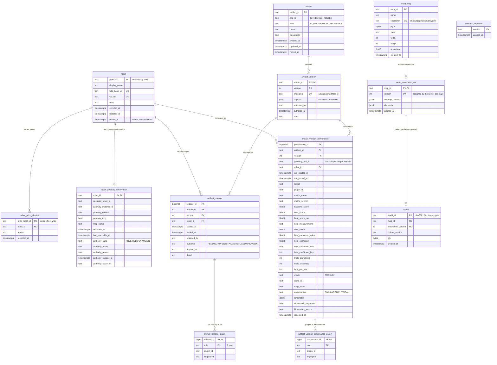

- **Retired, never deleted.** `robot` and `artifact` are retired through `retired_at`. NRR's run database holds runs stamped with a `robot_id`, and releases reference artifacts; deleting either would orphan that record. For the same reason almost every foreign key is `ON DELETE RESTRICT`. The only `CASCADE`s are `artifact_release_plugin` and `artifact_version_provenance_plugin`, which mean nothing without their parent.
- **RES does not issue IDs.** NRR declares the `robot_id`; RES only observes and checks it. The format is lowercase letters, digits and hyphens (`^[a-z0-9]+(-[a-z0-9]+)*$`), enforced by a CHECK. The on-screen name (`display_name`) belongs to RES, so renaming a robot never means changing an NRR's configuration.
- **Former names get their own table.** `prior_robot_id` is the primary key, so one name can belong to only one robot across the whole fleet. An array column cannot carry a fleet-wide constraint like that.
- **Both addresses are UNIQUE.** When robots on one host are told apart by port, a registration with the right HTTP port and the wrong WebSocket port would draw one robot's pose on two cards, smoothly and looking entirely correct. The server's identity check asks over HTTP, so it cannot catch this. Only the schema can, which is why `ws_url` got its own UNIQUE constraint (0003).
- **Content addressing.** `artifact_version.fingerprint` (sha256 of the payload with keys sorted), `world_map.fingerprint` and `world.world_id` are all derived from content. The same content lands on the same row.
- PGM and GLB bytes are stored as `BYTEA`, with no separate file store.
- The server never interprets `artifact_version.payload`. Its shape belongs to the workspace that authors it, and a second definition here would eventually disagree with the first.
- NRR's run database is read-only for RES and not owned by it, so it is not in this diagram. RES reads three of its tables: `navigation`, `navigation_execution_plugin` and `navigation_plugin_configuration`.

## DFD

### Level 0

One system (RES = GUI + server) and everything outside it. The robots and the simulator sit behind NRR; RES never reaches them directly.

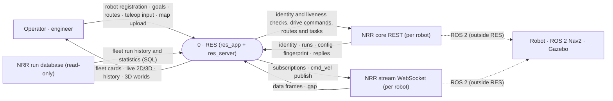

### Level 1 — server

Seven server processes and one data store. The GUI (res_app) is inside the system, so it is drawn as a process. Discovery and artifacts have no screen, so the person calling the API directly is drawn separately.

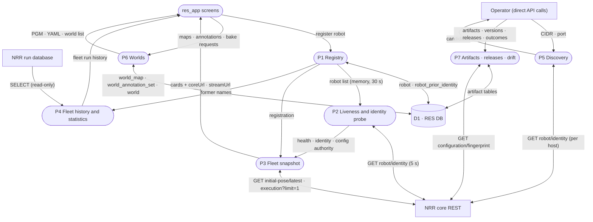

### Level 1 — GUI

Driving and live data never pass through the RES server. The GUI connects to NRR directly.

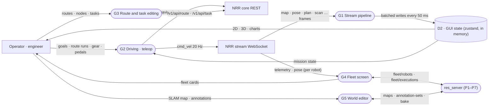

## Scenarios

### 1. Registering a robot and confirming its identity

A person registers a robot. But a registration only records what we believe; it does not make it true. Every 5 s the server asks each registered address who it is, and judges identity with the whole fleet in view. When the address is not known, network discovery offers candidates and nothing more. Discovery has no screen; it is called through the API.

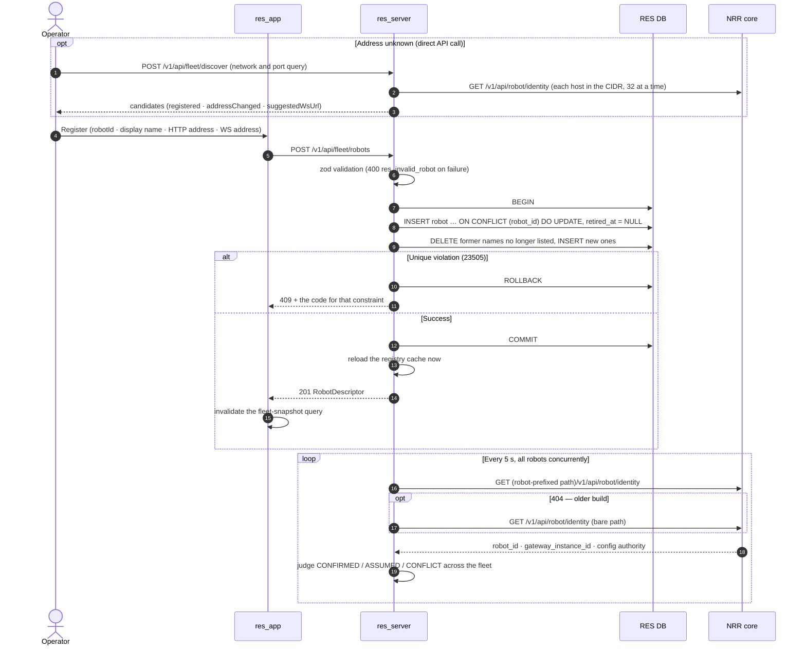

The 409 code is picked by constraint name: `res_robot_already_registered`, `res_http_base_url_already_registered`, `res_ws_url_already_registered`, `res_prior_name_belongs_to_another_robot`.

**Why it is built this way**

- **NRR declares the ID; RES only checks it.** If RES issued its own IDs there would be two identity spaces and a mapping table between them, and mapping tables rot. An address is not an identity either: IPs change. An address is how to reach a robot, not who it is.
- **The upsert is one transaction.** A robot with half its former names attached is a robot with half its history attached, and the identity check reads that as a conflict. Former names that stay listed are not deleted and rewritten, because `recorded_at` ("since when has it not used that name") is exactly what gets asked when identities look wrong, and correcting an address must not rewrite it.
- **The cache reloads right after a registration.** A card that appears 30 s later reads as a failed registration.
- **Identity is judged fleet-wide.** Two NRRs claiming the same name each look perfectly consistent on their own; only the pair reveals it. So both sides of a duplicate go into CONFLICT, including the one whose registry entry agrees. Reasons rank `duplicate_declaration` → `stale_identity` (declaring a former name) → `declared_mismatch`.
- **Liveness is polled.** The failure that matters most, the whole robot PC going dark, produces no message at all; only an unanswered probe reveals it. Any HTTP status, even a 404, means the process is up. Only silence counts as a failure, and it takes two in a row for OFFLINE. A card that flickers is a card nobody trusts.
- **Path shapes differ by NRR build.** Newer builds put the robot's name in the path; older ones do not. The server learns which one each NRR speaks while probing, and forgets it when `gateway_instance_id` changes, since a new process may be a different build.
- **Discovery only runs when asked, over a narrow range.** A management plane that sweeps the network on a timer is something to argue about with a security team every year, and adding a robot is rare. The range is limited to /22–/30 (the README measured 3.2 s for 254 hosts and 12.9 s for 1022). And only a person's registration admits a robot to the fleet, so a simulator someone starts at the next desk cannot walk in on its own and land in the fleet statistics.

### 2. Fleet home — snapshot and activity feed

The `/home` launcher draws every card from one fleet snapshot every 5 s. Values that change by the second, such as pose and speed, are not in the snapshot; the GUI subscribes to each robot's NRR stream directly. Every 10 s the RES server reads recent activity from NRR's run database.

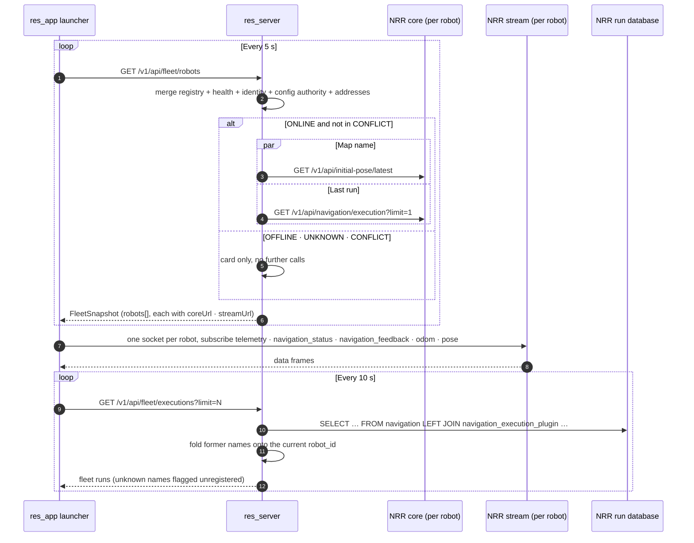

**Why it is built this way**

- **The server finishes the addresses.** Path shapes differ by NRR build, and the GUI should not have to know. It uses the `coreUrl` and `streamUrl` in the snapshot as they are.
- **Offline and conflicted cards get no extra calls.** Asking a dark robot for details only buys one timeout per field. And nothing an NRR in identity conflict says is attributed to this robot; until the conflict is resolved the card carries the conflict and nothing else. That also keeps wrong data out of the aggregates.
- **Live values are not relayed.** NRR's stream already fans out to many clients. Another hop through the server would only add something that can fall behind.
- **Fleet history is one SQL query.** It is not one HTTP request per robot. A robot that is switched off still appears in its own history, and adding robots adds rows rather than round trips. Runs a renamed robot recorded under its old name are folded onto its current name, and names the registry has never heard of are kept and flagged, not dropped: either nobody registered that robot or something went wrong with an identity, and both are worth a look.
- **Configuration authority comes for free.** Who holds the robot's configuration (FREE · HELD · UNKNOWN) rides on the 5 s identity answer, so it costs no extra call. UNKNOWN is not FREE; it means no readable answer. It is there to inform, not to block.
- **Cards show an identity conflict ahead of health.** The most dangerous robot is the one whose connection is fine and whose identity is wrong: it shows a green card while writing into someone else's history.

### 3. Opening a robot workspace — stream and identity gate

Choosing a robot opens the `/robot/:robotId` workspace. From here on the RES server is not in the path. The GUI connects to NRR directly with the addresses from the snapshot, and checks identity once more on the stream. Two things run side by side: the socket expects the ID registered in the snapshot, and a separate identity call asks NRR for the `robot_id` that command bodies carry.

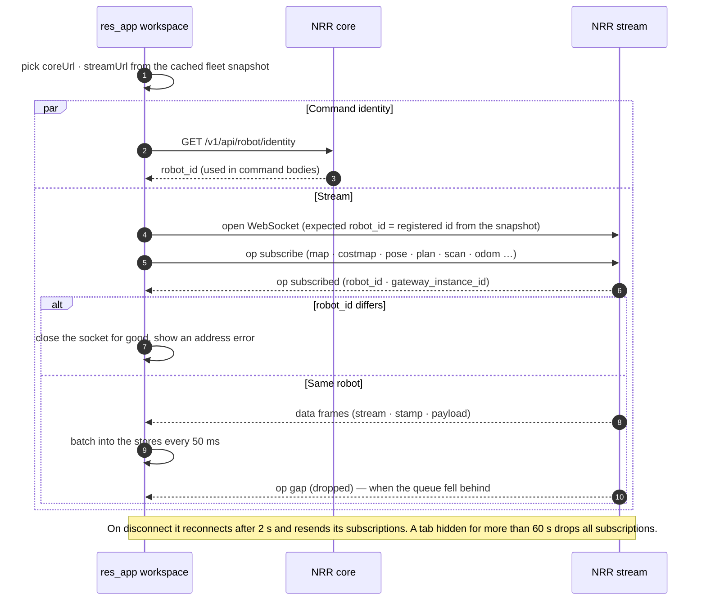

**Why it is built this way**

- **Identity is checked again on the stream.** The server's identity check asks over HTTP, so a registration with only the WebSocket address wrong gets past it. The GUI therefore compares the `robot_id` in the `subscribed` ack. If it differs, no retry will change the answer, so the socket is closed for good. Every frame's `robot_id` is also compared at one dispatch point, and a stranger's frame is dropped before any store sees it.
- **`gateway_instance_id` names the NRR process.** If it changes across a reconnect, NRR restarted while the GUI was away, and the GUI lets go of that robot's session state (such as a run it believed was in progress).

### 4. Missions — AMR goal and AGV route run

An AMR drives to a goal pose on the map; an AGV follows a saved route by ID. The GUI sends commands to NRR core directly and takes confirmation from `navigation_status` on the NRR stream. The RES server is not involved. Saving a route (`POST · PATCH /v1/api/route`) sits behind a build flag that defaults to a stub; listing, reading, deleting and presets are called without the flag.

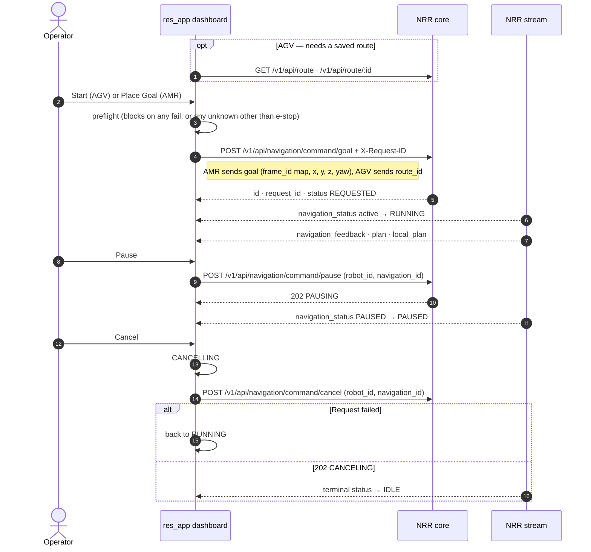

**Why it is built this way**

- **Commands go straight to NRR.** This is the decision from "Management plane and control plane" above.
- **The robot confirms pause and resume, not the click.** A 202 only means "accepted" (PAUSING); the stream says when the run is actually PAUSED. If NRR refuses, the button keeps saying Pause, which is the truth.
- **Cancel is one click.** A button that stops a drive already in motion should not wait two seconds for agreement. It enters CANCELLING at once, falls back if the request fails, and the stream confirms the end.
- **A command body is the robot plus exactly one identifier.** NRR rejects unknown fields. `navigation_id` is tried first; on a 400 the GUI retries with the `request_id` it dispatched itself.
- **The Start button and the BLOCKED badge share one rule.** They can never disagree about whether the robot may move.

### 5. Teleoperation — cmd_vel and the mission lock

The teleop screen publishes `cmd_vel` straight onto the NRR stream from a steering wheel, pedals and P/R/N/D gears. The RES server is not involved here either.

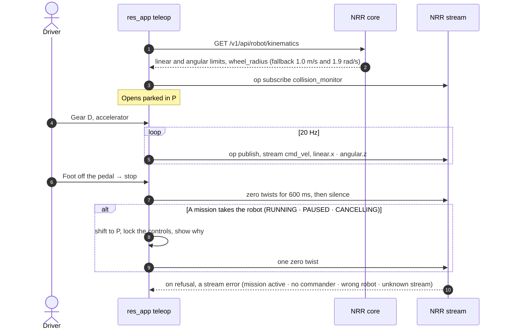

**Why it is built this way**

- **The gear is the gate.** There is no ARM toggle. P is a parking brake that engages at any speed; D is refused while rolling backward and R while rolling forward. The interlock lives in a pure model, not in CSS.
- **After a stop it sends zeros for 600 ms, then goes quiet.** An open tab once kept publishing zeros at 20 Hz and fought another publisher (code comment, 2026-09-15). According to the code comments, the quiet that follows is covered by a 500 ms deadman on the NRR side. That is NRR behaviour and was not verified from RES code.
- **After a mission ends the gear stays in P.** The lock lifts, but the driver has to put it in gear to move again. Control is offered back, never pushed back.
- **There is no success ack.** Only refusals come back, as stream errors.

### 6. SLAM map → baked 3D world

In the editor an engineer cleans up a SLAM map (PGM + YAML) and gives walls, objects and virtual walls a height; the server then bakes a 3D world (.glb). The same `@res/world-builder` package runs in the browser (preview) and on the server (bake).

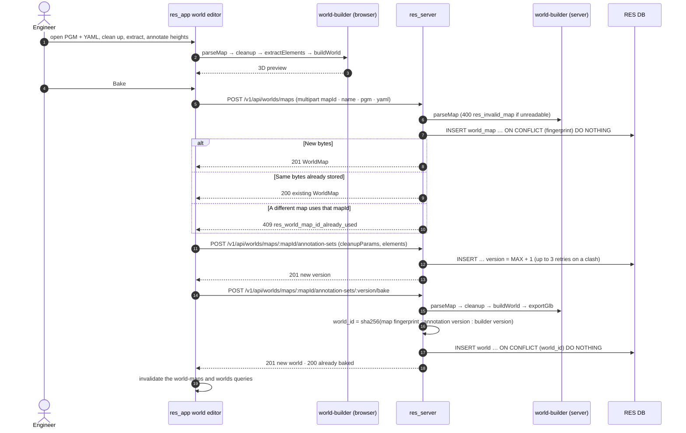

**Why it is built this way**

- **Three tables for three lifetimes.** A map is immutable bytes. An annotation set is a person's work and versions upward. A world is a deterministic bake of the two and can always be recreated. Nothing is updated in place; a correction is a new version.
- **Uploads are content-addressed.** Uploading the same bytes again answers 200 with the map that already holds them, under the ID it was first given. Different bytes under a taken ID answer 409.
- **An annotation set stores its cleanup parameters.** The blobs the annotations sit on only exist under those parameters. The server numbers versions per map; when two saves race to the same number, the loser is retried with the next one instead of showing an error to someone who did nothing wrong.
- **The builder version is part of `world_id`.** A builder release that changes heuristics must produce a different world, not overwrite one. The same three inputs always give the same glb, so baking is idempotent.
- **Preview and bake are the same code.** What the editor shows is what gets baked.
- **Not connected yet.** The server serves the glb at `GET /v1/api/worlds/:worldId/model.glb`, but the GUI does not load it yet. The robot dashboard's 3D view uses the Gazebo scene that NRR serves.

### 7. Configuration artifacts → releases → drift

An API for keeping configuration, task and device artifacts as versions, recording which robot each was released to, and asking whether the robot is still running it (drift). The server, unit tests for fingerprinting and drift, and Bruno requests are built. Wiring it into the GUI is still a proposal, so there is no screen.

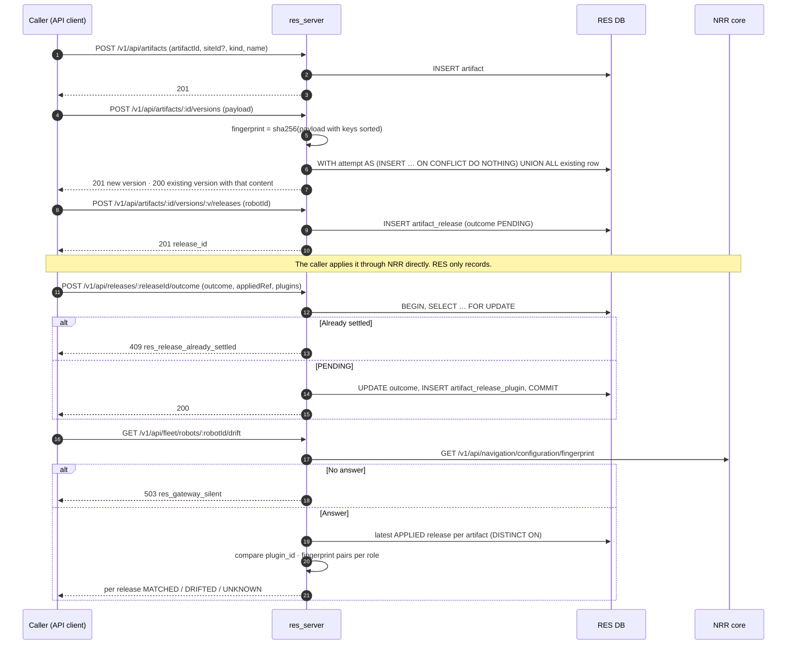

**Why it is built this way**

- **One sentence explains the service.** What was made, what was sent out, and is the robot still running it. Without the third clause it is a file server.
- **Artifacts are keyed by site, not robot.** Keyed by robot, releasing to three robots would mean three copies, and copies drift. Robots appear only on releases, one row per robot: three robots where one fails is an ordinary outcome, and a single row listing targets cannot say so.
- **Versions are content-addressed.** Saving unchanged content returns the existing version instead of minting a number. Reverting to v1's content is v1, because it is. It is one SQL statement, so two people saving the same content at the same moment cannot race into two versions of it.
- **Nothing NRR already knows is copied.** A release records what NRR calls the thing it applied (`applied_ref`), not a copy of the payload. Two copies of one value drift, and after they drift nobody can say which is true.
- **A release is written as PENDING before NRR is called.** If the caller dies mid-flight a visible row is left behind. A lost event is worse than an unknown one, because an unknown one asks to be looked at.
- **REFUSED is not FAILED.** What a caller wants to know is whether pressing the button again is safe. REFUSED means NRR declined before writing anything, so nothing on the robot changed. FAILED means nothing is known about the robot; read the fingerprint first.
- **An outcome is accepted once.** Merging a second report would make the history depend on which retry arrived last. To try again, open a new release.
- **Drift compares (plugin_id, fingerprint) pairs per role.** Comparing fingerprints alone gives a false "unchanged" when a robot switches to a different plugin, because the released plugin's fingerprint never moves. Only the roles the release touched are examined: reporting someone else's change to another role as drift would teach people to ignore the alarm. A release with no compared roles is UNKNOWN, never MATCHED.
- **Provenance lives outside the payload.** When a parameter auto-tuning result lands as an ordinary CONFIGURATION version, which run, metric, robot and environment it came from are values the server has to read, so they cannot sit inside a payload it promised not to look into. Two runs that reach the same values are evidence, not a collision, so one version may have many provenance rows.

## Errors and state

### One error shape

- Every error leaves through one global filter (`@Catch()`) in the same shape: `{ error, message, detail, source, request_id }`.
- `error` is a catalogue code. There are 36: five shared, unprefixed codes spelled the same as NRR's (`not_found`, `method_not_allowed`, `invalid_request_body`, `invalid_parameter`, `internal_error`) and 31 RES-specific `res_` codes. The code alone tells a client which server to ask about it.
- The catalogue holds the status, the fixed wording and the `source`; a call site holds only the code and a `detail` that is true of that one occurrence. A code that is not in the catalogue is a type error and does not compile.
- `source` says where to look: the request, RES itself, NRR, the robot, or infrastructure. It is what lets the GUI tell apart two 503s: `res_gateway_silent` (NRR did not answer) and `res_gateway_database_unavailable` (NRR's run database could not be reached).
- Postgres unique and foreign-key violations (23505 · 23503) are turned into catalogue codes by constraint name. An unanticipated constraint still answers a catalogued code rather than a 500, with the constraint name in `detail`.
- An unhandled exception returns only `500 internal_error` and a `request_id`. The stack goes to the log under the same `request_id`.
- Errors Nest raises on its own (an unknown path, an unreadable body) are reshaped too. Left alone, their `error` field holds an HTTP phrase such as "Not Found" that looks like a code and matches none.
- Messages are in English. The GUI branches on the code and writes its own operator wording; the server's message is the fallback for a code it does not know.

### State the server tracks

| Subject | Values | Rule |
| --- | --- | --- |
| health | ONLINE · OFFLINE · UNKNOWN | Any HTTP answer is ONLINE. Two silent probes in a row make OFFLINE; until then the previous verdict stands. DEGRADED and INOPERATIVE exist in the contract but are not produced yet |
| identity | CONFIRMED · ASSUMED · CONFLICT | Declared = registered is CONFIRMED, no declaration is ASSUMED, anything else is CONFLICT. Nothing is attributed to a robot in CONFLICT |
| config authority | FREE · HELD · UNKNOWN | From the last probe that answered. An answer without a readable identity sets UNKNOWN; a probe that gets no answer leaves the last value in place. UNKNOWN is not FREE |
| release outcome | PENDING · APPLIED · FAILED · REFUSED · UNKNOWN | See the diagram below |
| drift (per role) | MATCHED · PLUGIN_CHANGED · PARAMETERS_CHANGED · UNAVAILABLE | Per release: any changed role makes DRIFTED; otherwise any unreadable role, or no compared role at all, makes UNKNOWN; else MATCHED |

A release outcome is settled once. The rules `(outcome = PENDING) = (settled_at IS NULL)` and "a REFUSED release has no `applied_ref`" are CHECK constraints in the schema.

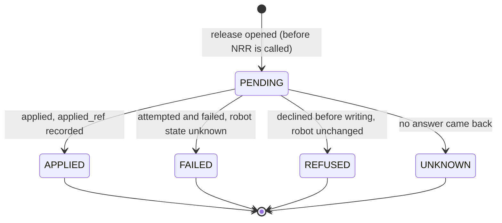

### Failure modes

- **RES DB.** If the registry cannot be read at boot, the server does not start: serving an empty fleet looks exactly like a fleet that is switched off. A failed periodic reload keeps the previous answer.
- **NRR's run database.** Without a read-only account configured, only fleet history and statistics answer `503 res_gateway_database_unavailable`; everything else runs. That beats a server that refuses to start over a missing statistics account. The connection uses an account granted SELECT only, and the session also sets `default_transaction_read_only=on` and a statement timeout.
- **NRR.** A silent NRR leaves an OFFLINE card and no further calls. A direct query such as drift answers `503 res_gateway_silent`. Probes go to every robot concurrently, so one dark robot's timeout (2 s) never delays the report on the others.
- **Environment.** If validation fails at boot, the server logs one line and exits with code 1.

### GUI side (summary of the state and exception spec)

The `docs/06` state and exception spec covers the GUI's states. Where the code has moved past the doc, this follows the code.

- **Stream connection.** `idle → connecting → connected`, then `closed` or `error` on loss. It reconnects after 2 s and resends its subscriptions. The last data received is not cleared.
- **Preflight has three states.** ok · fail · unknown, with fail in red and unknown in amber, so a reported fault and an unobserved value look different. The doc says an unknown e-stop also blocks Start; the code decided it does not, because NRR publishes no e-stop state today and blocking on it would refuse every drive forever. It stays on the panel as `N/A` so the gap is visible, and an unknown localization still blocks.
- **Cancel.** The doc still describes a two-second hold and a local return to IDLE (marked TBD). The code is the one-click cancel confirmed by the stream, as in scenario 4.
- **Simulator off.** When NRR answers 503, the GUI shows a quiet empty state ("Simulation not running") rather than a red error.
- **Principles.** A recoverable error keeps the draft, viewport and selection. Nothing auto-closes in a way that could make a failed save look like a success.
- The "standard error response shape" the doc left as TBD is, on the RES server side, the single error shape above.

## Not built yet

- Authentication and sessions.
- A health transition log (`robot_health_event`) and alerting. When it is built, it is to record transitions, not a sample every 5 s.
- DEGRADED and INOPERATIVE health, and dependency reporting from NRR's `/healthz`. The reader exists but is not wired into the probe, so every card's dependency list is empty ("not reported", not "nothing is wrong").
- Persisting `robot_gateway_observation`.
- Periodic drift checks, payload validation, an approval step.
- Artifact and release screens in the GUI, and glb loading in the GUI.
- `@res/world-builder`'s builder-version constant is kept in sync by hand and has fallen behind the package version; `world_id` is computed from that constant.
- Server-side parameter auto-tuning orchestration (shelved).

## Looking back

[//]: # "TODO: what worked in the server design, what I would change, what I learned"
