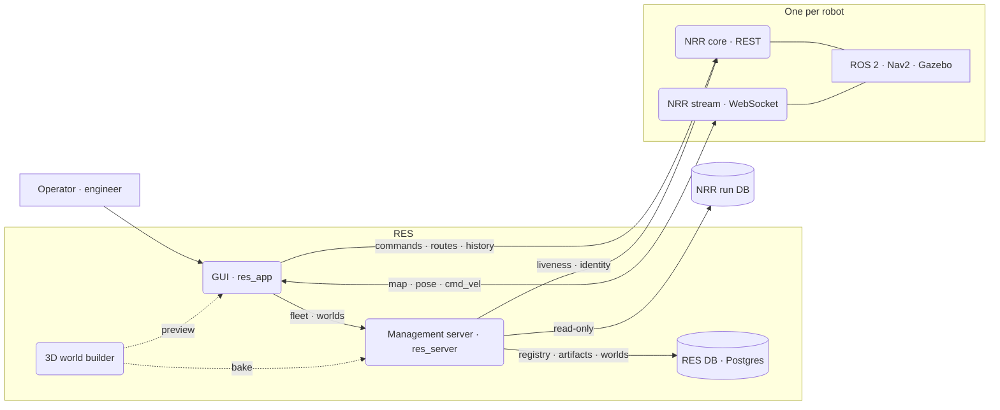

<figure>
<picture>
<source media="(prefers-color-scheme: light)" srcset="/projects/res/dashboard-light.webp">

</picture>
<figcaption>Robot dashboard — a robot running a route. The 2D SLAM map and the 3D world side by side, six telemetry charts below. Captured against simulated robots; some robot and world names and all addresses were changed for publication.</figcaption>
</figure>

## What it is for

Every robot runs its own NRR (Native Robot Runtime). The NRR drives that robot and is the authority on its state. For one robot, that is enough.

With several robots, questions appear that no single NRR can answer. Which robots exist? Which are answering? Is each one the robot we think it is? What does the fleet look like right now? RES is where those questions get answered.

The screens are modelled on a PLC development environment (an IDE). Each robot is a project. Opening it gives one workspace for monitoring, routes, history, statistics, configuration and tuning.

The screen definitions name its users: operators, tuning engineers and integration developers.

## What it does

### Fleet launcher

Every registered robot on one screen. The left column lists the robots, the middle previews the selected robot's map (with the other robots on that map), and the right shows its details, an attention list, worlds and recent runs. The launcher never moves a robot.

Status badges follow a fixed order. An identity conflict outranks health, and health outranks the stream connection. A lost stream is not treated as a dead robot.

<figure>
<picture>
<source media="(prefers-color-scheme: light)" srcset="/projects/res/launcher-light.webp">

</picture>
<figcaption>Fleet launcher — of seven robots, two are driving and three have lost their connection and sit in the attention list. The map shows the picked robot together with the others on the same map.</figcaption>
</figure>

### Robot workspace

Opening a robot from the launcher leads here. It has seven views.

| View | What it does |
| --- | --- |
| Dashboard | Commissioning with the 2D SLAM map and the 3D simulation world side by side. Initial pose (manual or automatic), goal driving (AMR), route driving (AGV), pause, resume and cancel. The preflight check has three states — ok, fail, unknown — and an unknown value such as localisation does not count as a pass. The 2D map is drawn the way RViz draws it. The 3D view shows URDF robot models, a chase camera, the other robots on the same map and a camera robot's image. Six telemetry charts. |
| Teleop | Sends `cmd_vel` at 20 Hz from a car-style cockpit (steering wheel, pedals, gauges) or a joystick. The P · R · N · D gear is the safety interlock: D does not engage while rolling backward, R does not engage while rolling forward. While a mission runs, the controls lock and say why. |
| Route & Task | Route catalogue, node editing and a task per node. Saving to the robot side sits behind a build flag that defaults to a stub. |
| History | Filter past runs, open one in detail, overlay several to compare. |
| Statistics | Group runs by axes such as route, controller and environment, and see the distribution and ranking of each measurement. Three modes: report, charts and A/B comparison. |
| Optimization | Starts a controller-parameter auto-tuning run that executes on the robot side and follows it over the stream: convergence curve, trial table, re-measure, apply. Applying waits for the Nav2 reconfigure to finish. The screen states its conclusion first. |
| Config | Edit ROS 2 parameter YAML as a form or as raw YAML and apply one change set. The screen is built, but the robot-side API does not exist yet, so by default it reads a fixture. |

AGV mode follows a route made of nodes; AMR mode finds its own way to a goal. There are light and dark themes.

<figure>

<figcaption>Teleop cockpit — the gear (P R N D) is the gate. Nothing is commanded in P.</figcaption>
</figure>

### From a SLAM map to a 3D world

Upload a SLAM map (PGM + YAML), clean up the noise, extract walls and objects, draw virtual walls by hand, and give them heights. The server then bakes a `.glb` 3D world. Annotations are kept as versions.

The editor's 3D preview and the server's bake use the same package (`@res/world-builder`), so what you preview is what gets baked. The same map, annotation version and builder version give a byte-identical `.glb`, and worlds are addressed by that content. When a map is re-made, annotations are re-attached; the ones that cannot be matched are handed back, never deleted.

<figure>

<figcaption>World editor — the demo map in the 2D | 3D split while element heights are being confirmed (10/33). Confirmed elements are blue, guessed heights orange.</figcaption>
</figure>

### Management server

- **Fleet registry** — register, correct, retire. Robots are retired, not deleted.
- **Liveness** — asks each NRR every 5 seconds and marks a robot OFFLINE only after two failures in a row.
- **Identity** — decides whether each robot is the one we think it is: CONFIRMED, ASSUMED or CONFLICT.
- **Fleet snapshot** — one call returns a finished address per robot, so the GUI never assembles addresses.
- **Fleet history and statistics** — read from the NRR's run database, read-only.
- **Network discovery** — only proposes candidates; a person adds them to the fleet.
- **Worlds** — map upload, annotation versions, baking and serving the model.
- **Artifacts and releases** — versioned configuration, task and device artifacts (same content, same version), release records per robot, and drift detection: whether a robot's live configuration still matches its last release.

Errors come from one catalogue, and the OpenAPI document generated from the controllers is the contract with the GUI.

### Not built yet

- Authentication. The system assumes a closed network; auth was left for a later phase.
- The robot-side configuration API. Route saving also defaults to a stub.
- Screens for artifacts, releases and network discovery. Only the server API exists: artifacts and releases with unit tests and Bruno requests, discovery with a unit test of its address range.
- Loading the baked `.glb` in the GUI. The dashboard's 3D view draws the Gazebo scene the NRR provides.
- Configuration, task and device engineering workspaces, and a multi-robot workspace for a whole floor. Each has a definition page only — on purpose, rather than controls that pretend to work.
- Server-side management of parameter auto-tuning. Partly built on a branch, then shelved.
- CI.

## Architecture at a glance

- **The GUI talks to three kinds of server.** The RES server (fleet, worlds), and per robot the NRR core (REST) and the NRR stream (WebSocket). The only address built into the GUI is the RES server's; robot addresses arrive in the fleet snapshot.
- **The server only manages.** The NRR is what drives a robot. The server never commands a robot and never writes to one. Drive commands and live streams go straight from the GUI to the NRR.
- **The GUI never connects to ROS directly.** It started on rosbridge and moved to the NRR stream on 2026-08-18.
- **State lives in two places.** REST responses in the TanStack Query cache, live streams in zustand stores. No React Context carries state.
- **Storage.** The RES DB (Postgres) holds the registry, artifacts and worlds, including the map PGM and GLB bytes. There is no ORM, only numbered SQL migrations. Run history stays in the NRR's database, which RES only reads.

## Platforms

There is one `src/` with no platform branches at all. What differs per platform lives only in the packaging under `platforms/`, so whatever works on the web works everywhere.

| Platform | Packaging | Status |
| --- | --- | --- |
| Web | Vite dev server, static build | Built and running |
| Desktop | Electron 44 — served from an `app://` scheme, CORS headers added only to responses that lack them, sandboxed renderer | Linux AppImage and deb built and run. Windows and macOS configured only |
| Android | Capacitor 8.5 | Debug APK built and checked on an emulator |
| iOS | Capacitor 8.5 | Xcode project generated; never run, as no macOS machine was available |

On 2026-10-26, Electron and the Android emulator were checked over the Chrome DevTools Protocol: the launcher's robot list, REST including preflight, deep-link reload, the live 2D map stream and 3D textures (zero errors).

There is no signing, auto-update or CI. The server address is fixed at build time, and the dashboard is designed for a desktop screen.

## Timeline

| Date | Version | What |
| --- | --- | --- |
| 2026-08-10 | GUI 0.1.0 | Split out of a larger repository; started as a single-robot dashboard |
| 08-14 | GUI 0.2.0 | Preflight check, mission progress |
| 08-18 | GUI 0.3.0 | rosbridge replaced by the NRR stream |
| 08-19 | GUI 0.4.0 | History, Route and Config screens |
| 08-21 | GUI 0.5.0 | AGV / AMR split, URDF robots in 2D and 3D |
| 08-25 | GUI 0.6.0 | Statistics — ranking, validation, A/B comparison |
| 08-28 | GUI 0.7.0 | 3D chase camera |
| 09-01 | GUI 0.8.0 | Cancel, pause, resume; Route & Task |
| 09-02 | Server 0.1.0 | First server commit (in its own repository at the time) |
| 09-03 | GUI 0.9.0 · Server 0.4.0 | `/home` launcher, robot as a project, every robot on one map · server discovery and liveness |
| 09-04 | GUI 0.10.0 · Server 0.6.0 | Renamed to the current name, role tokens and light theme · artifacts and releases |
| 09-09 | GUI 0.11.0 | Optimization screen |
| 09-11 | Builder 0.1.0 → 0.3.1 · Server 0.9.0 · GUI 0.12.0 | World builder, server worlds domain and world editor, in one day |
| 09-15 – 16 | GUI 0.13.0 · 0.14.0 | Teleop cockpit, then P · R · N · D gears and gauges |
| 09-28 | GUI 0.15.0 | Saved view settings, glb meshes |
| 10-13 | GUI 0.16.0 | Optimization scoring, GP-BO, convergence curve, re-measure |
| 10-15 | GUI 0.17.0 | Camera robot image over the 3D view |
| 10-19 | GUI 0.18.0 | Simulated robots drawn at the simulator's ground-truth pose |
| 10-26 | GUI 0.19.0 | Web, Electron, Android and iOS packaging; server repository merged in with its history |
| 10-27 | Server 0.12.0 | The server's five internal packages folded into domain folders |
| 10-29 | — | Last commit. Work moved on to a successor project |

## Scale

Counted at the last commit (2026-10-29).

- **Commits** — 676 over 40 commit days (August 243 · September 355 · October 78). By type: feat 268 · fix 237 · docs 70 · refactor 31 · perf 27 · chore 22.
- **Packages** — 3: `@res/app` 0.19.1, `@res/server` 0.12.0, `@res/world-builder` 0.3.1.
- **GUI** — 11 screen routes (7 of them per-robot views) plus 4 definition pages for planned workspaces, 19 feature folders. 316 source files with 57,664 lines; 163 test files with 27,353 lines.
- **Server** — 8 controllers, 33 route handlers, 10 SQL migrations, 9,131 source lines, 17 test files, 48 Bruno API requests. The shelved tuning domain is excluded.
- **3D world builder** — 1,285 source lines, 9 test files, 1 runtime dependency (earcut).
- **Docs** — 48 screen, feature and interface design documents, 20 GUI implementation documents, 5 server design documents.

## My role

A solo project, with one commit author: me. I decided what to build, how each screen should look and behave, and where the line between server and GUI goes. I built it with Claude Code: 601 of the 676 commits carry a Claude co-author line. Behaviour was checked against simulated robots in Gazebo.

[//]: # "TODO: where the line was between what I did myself and what I handed to the AI; the one or two design calls that mattered most"

## Looking back

[//]: # "TODO: what I learned, what I would do differently"
