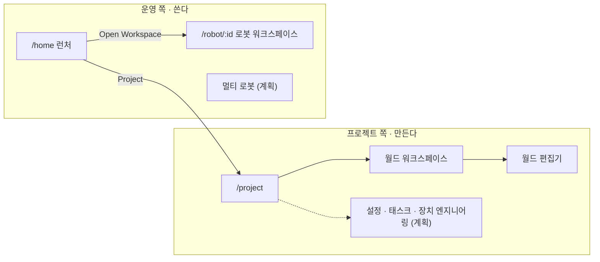
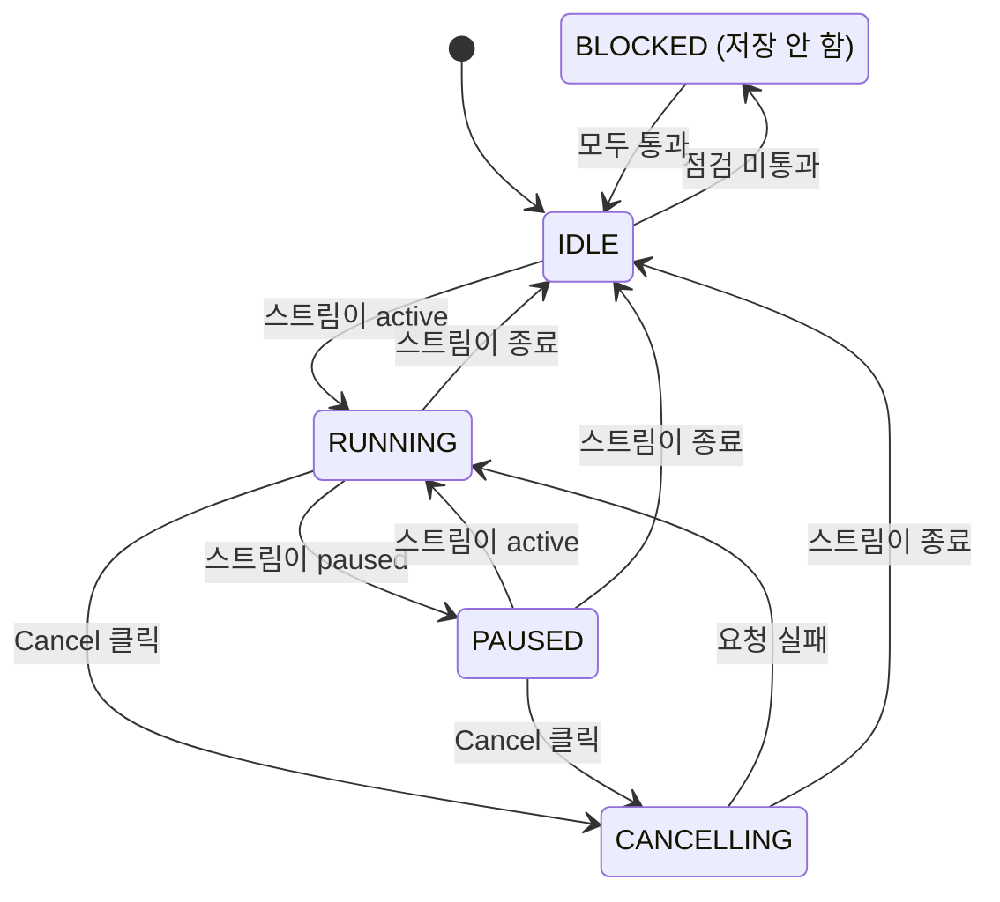
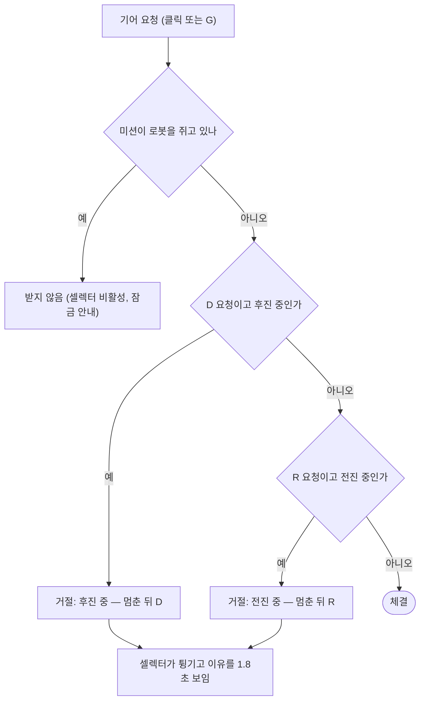
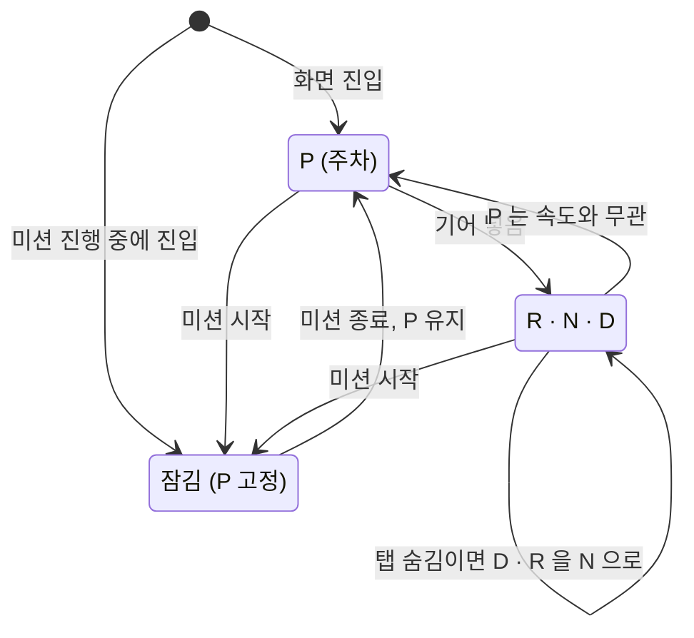
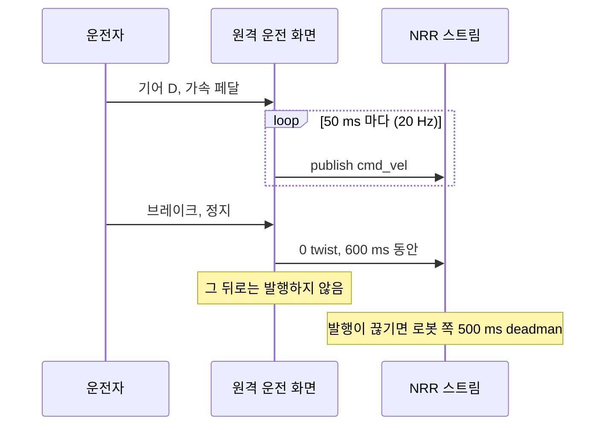
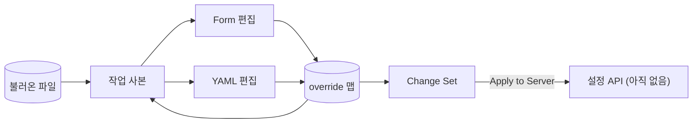

[//]: # "채울 것: 현재 UI 캡처. 런처 · 대시보드 · 원격 운전 콕핏 · 경로 & 태스크 · 설정(Form/YAML) · 월드 편집기, 라이트 · 다크"

RES 의 화면은 로봇 여러 대를 다루는 계기판이다. 글씨는 작고, 패널은 촘촘하고, 프레임은 카드보다 도면에 가깝다. 이 페이지는 그 화면을 어떤 원칙으로 정했는지, 어떤 토큰으로 그렸는지, 화면마다 무엇이 어디에 있고 어떻게 움직이는지를 정리한다.

기준은 `@res/app` 0.19.1 의 코드다. 예전 기획 문서와 코드가 다른 곳은 코드를 따랐다.

## 설계 원칙

코드 주석과 설계 문서에 적어 두고 지킨 규칙들이다. 끝에 근거 파일을 붙였다.

1. **빈 것은 비어 있다고 보인다.** 가짜 데이터가 진짜 행세를 하지 않는다. 등록된 로봇이 없으면 "No robots", 짧은 한국어 안내, 등록 버튼만 나온다. 포즈를 모르면 로봇을 그리지 않는다. 2D 지도는 데이터가 없는 레이어를 숨기지, 가짜 도형으로 채우지 않는다. 월드 편집기의 합성 지도 하나는 직접 골라야 열리고 DEMO 표시가 붙는다. 설정 화면의 fixture 에는 STUB 표시가 붙는다. — `HomePage.tsx`, `demoMap.ts`, 대시보드 화면 정의 §4
2. **모르는 것은 통과가 아니다.** 출발 전 점검(preflight)은 ok · fail · unknown 세 값이다. unknown 은 황색, fail 은 적색이다. 위치 추정처럼 확인되지 않은 항목이 있으면 Start 가 막힌다. 모르는 값은 `—` 로 두고, 진행률을 모르면 0% 대신 빗금 막대를 그린다. 예외가 하나 있다. 로봇 쪽이 비상정지 상태를 아예 내보내지 않으면 `N/A` 로 보이되 막지는 않는다. 막으면 영영 출발할 수 없기 때문이다. — `dashboardStore.ts`, 대시보드 화면 정의 §3
3. **가장 위험한 실패가 가장 초록색일 수 있다.** 로봇 카드의 판정 순서는 신원 충돌 → 서버의 생존 확인 → 스트림 소켓이다. 자기가 다른 로봇이라고 말하는 NRR 은 멀쩡히 응답하면서 남의 이력에 쓴다. 그래서 Conflict 가 초록을 덮는다. 생존 확인은 되는데 소켓만 끊겼다면 로봇이 죽은 게 아니라 스트림을 잃은 것이다. 이건 No Stream(황색)으로 따로 말한다. — `fleetModel.ts`
4. **계획만 있는 화면은 정의만 보인다.** 아직 만들지 않은 워크스페이스는 흉내 낸 도구 대신 무엇을 맡을지 적은 정의 페이지를 띄운다. 쓸 수 없는 컨트롤은 없는 것보다 나쁘다. — `workspaces.ts`, `PlannedWorkspacePage.tsx`
5. **그린 것에 대한 컨트롤만 둔다.** 경로 & 태스크 화면은 로봇을 그리지 않는다. 그래서 로봇 가운데 두기 · 따라가기 · 로봇 기준 회전 버튼을 빼고, 따라가기도 꺼 둔다. — 경로 화면 정의 §1
6. **첫 상태는 그 화면의 일에 맞춘다.** 원격 운전은 P 에 주차된 채 바로 조작할 수 있는 상태로 열린다. 3D 뷰는 로봇 뒤를 따라가는 카메라로 열린다. 운전하는 사람은 로봇이 가는 쪽을 보기 때문이다. 통계는 분포부터 보이는 Charts 모드로 열린다. — `TeleopPage.tsx`, `useViewMode.ts`
7. **실물로 그린 컨트롤은 실물처럼 움직인다.** 기어 셀렉터는 색만 바꾸지 않고 움직인다. 스틱은 게이트를 따라 미끄러지고, 다이얼은 돌고, 거절된 변속은 튕긴다. 페달에는 유격과 밟히는 시간이 있고, 방향키 조향은 가운데에서 한 번 멈춘다. 운전대 · 페달 · 계기판은 두 테마 모두 어둡다. 라이트 테마라고 운전대가 베이지색이면 다른 차가 된다. — `GearSelector.tsx`, `teleopModel.ts`, `SteeringCockpit.tsx`
8. **자율 주행이 로봇을 잡으면 수동 조작은 잠기고, 이유를 보인다.** 미션이 RUNNING · PAUSED · CANCELLING 이면 원격 운전은 P 로 잠기고 안내가 뜬다. 미션이 끝나도 P 에 그대로 있다. 제어권은 돌려주되 떠밀지 않는다. 설정 화면도 다른 쪽이 설정을 쥐고 있으면 Locked 배너와 그쪽으로 가는 링크를 띄운다. — `useTeleopController.ts`, `ConfigWorkspace.tsx`
9. **SLAM 지도는 RViz 와 같은 모양으로 그린다.** 지도 색은 취향이 아니라 ROS 에서의 의미다. 그래서 2D · 3D 캔버스는 두 테마 모두 어둡고, 상수는 RViz 의 Nav2 기본 설정에서 그대로 옮겨 왔다. — `tokens.css`, `rvizNavigation2ViewConfig.ts`
10. **완성된 화면에 설명 문장을 넣지 않는다.** 설명은 올리면 바로 뜨는 `HoverHint` 로 둔다. 브라우저 기본 `title` 툴팁은 늦게 뜨고, 글씨가 작고, 꾸밀 수 없어서 아이콘 버튼의 짧은 이름에만 쓴다(대시보드 · 런처 · 이력 · 설정 화면 몇 곳에는 아직 설명 문장이 `title` 에 남아 있다). 다만 판정 문장(주의 목록, 출발 전 점검 사유, 잠금 사유)은 한국어 문장으로 쓴다. 라벨은 영어, 판정은 한국어다. — GUI 문서 07 §4, 런처 디자인 브리프
11. **접근성은 잰다.** 대비를 재서 토큰 옆 주석에 적었다. 9–11px 글자에 쓰는 muted 색은 WCAG AA 4.5:1 을 넘기도록 값을 올렸다. `prefers-reduced-motion` 을 따르고, 아이콘만 있는 버튼에는 `aria-label` 을 단다. — `tokens.css`, GUI 문서 07 §3
12. **성능 때문에 화면을 깎지 않는다.** 바뀐 게 없으면 그리지 않는다. 2D 는 요청이 있을 때만 한 프레임, 3D 는 `frameloop="demand"` 다. 픽셀 비율은 1.5 에서 자른다. 스트림은 50 ms · 250 ms 단위로 모아 store 에 쓰고, 그래서 생기는 끊김은 포즈 보간으로 메운다. — GUI 문서 06 §4

## 색과 토큰

화면 틀(패널 · 글자 · 배지 · 버튼 · 표 · 대화상자)의 색은 모두 역할 토큰에서 온다. 토큰은 라이트와 다크로 두 번 정의한다. 전역 CSS 의 화면 틀 규칙에는 색 값을 직접 쓰지 않는다. 색 값 하나가 남아 있으면 그 패널은 테마를 따라가지 못한다. 전역 CSS 에 남은 색 값은 두 테마에서 같아 보여야 하는 것들이다. 캔버스와 그 위에 뜨는 오버레이, 범례, 원격 운전 하드웨어, 그림자, 모달 뒤를 덮는 막.

- 라이트 값이 기본 토큰 세트다. 처음 설치하면 System 이라 `<html data-theme>` 이 비어 있고 OS 설정을 따른다. Light · Dark 를 고르면 값이 들어간다. 토글은 Light · Dark · System 세 버튼이다.
- 캔버스와 데이터 색은 테마를 따라 바뀌지 않는다.

### 면

| 토큰 | 라이트 | 다크 | 쓰임 |
|---|---|---|---|
| `--app-bg` | &nbsp;`#eef1f5` | &nbsp;`#07111c` | 페이지 바탕 |
| `--header-bg` | &nbsp;`#ffffff` | &nbsp;`#09131f` | 헤더 |
| `--rail-bg` | &nbsp;`#f7f9fb` | &nbsp;`#0a1420` | 내비게이션 레일 |
| `--panel-bg` | &nbsp;`#ffffff` | &nbsp;`#0d1824` | 패널 |
| `--panel-bg-elevated` | &nbsp;`#ffffff` | &nbsp;`#111d2a` | 떠 있는 패널 |
| `--panel-header-bg` | &nbsp;`#fbfcfd` | &nbsp;`#0c1722` | 패널 머리 |
| `--inset-bg` | &nbsp;`#f2f5f8` | &nbsp;`#08121b` | 들어간 칸 |
| `--hover-bg` | &nbsp;`#f4f7fa` | &nbsp;`#111d2a` | 올렸을 때 |
| `--overlay-bg` | &nbsp;`rgb(255 255 255 / 94%)` | &nbsp;`rgb(9 21 32 / 94%)` | 떠 있는 판 |
| `--scrim` | &nbsp;`rgb(18 26 36 / 42%)` | &nbsp;`rgb(2 8 14 / 76%)` | 대화상자 뒤 |

### 선과 글자

| 토큰 | 라이트 | 다크 | 쓰임 |
|---|---|---|---|
| `--border-subtle` | &nbsp;`#e7ebf0` | &nbsp;`#1b2938` | 패널 안 구분선 |
| `--border` | &nbsp;`#d3dae2` | &nbsp;`#243244` | 패널 테두리 |
| `--color-border-strong` | &nbsp;`#adb8c4` | &nbsp;`#34465a` | 가리키는 대상의 테두리 |
| `--text-primary` | &nbsp;`#10161d` | &nbsp;`#e7edf5` | 본문 |
| `--text-secondary` | &nbsp;`#4c5762` | &nbsp;`#93a1b3` | 보조 글자 |
| `--text-muted` | &nbsp;`#626d78` | &nbsp;`#7e8ea2` | 9–11px 라벨. AA 4.5:1 을 넘기도록 올린 값 |
| `--on-solid` | &nbsp;`#ffffff` | &nbsp;`#ffffff` | 채운 버튼 위 글자 |

### 주 색과 판정 색

판정 색은 선 · 틴트 · 잉크(틴트 위 글자) 세 가지가 한 벌이다. 배지는 이 셋으로 이루어지고, 셋은 같이 움직여야 한다.

| 토큰 | 라이트 | 다크 | 메모 |
|---|---|---|---|
| `--primary` | &nbsp;`#1668d6` | &nbsp;`#0e6ff7` | 다크 값은 흰 글자 대비 4.53:1. 원래 쓰던 #1677ff 는 4.10:1 이었다 |
| `--primary-ink` | &nbsp;`#14559f` | &nbsp;`#9ec4ff` | |
| `--primary-soft` | &nbsp;`rgb(22 104 214 / 8%)` | &nbsp;`rgb(22 119 255 / 14%)` | |
| `--success` | &nbsp;`#16884a` | &nbsp;`#21c76a` | |
| `--success-ink` | &nbsp;`#10683a` | &nbsp;`#67e99a` | |
| `--warning` | &nbsp;`#9a6a06` | &nbsp;`#d7a522` | |
| `--warning-ink` | &nbsp;`#7d5605` | &nbsp;`#ffe089` | |
| `--danger` | &nbsp;`#c22c33` | &nbsp;`#df454a` | |
| `--danger-ink` | &nbsp;`#9d2229` | &nbsp;`#ffc5c8` | |
| `--info` | &nbsp;`#006fa8` | &nbsp;`#25a7e8` | 라이트 값은 자기 틴트 위 4.56:1, 흰 바탕 위 5.47:1 |
| `--info-ink` | &nbsp;`#0c6693` | &nbsp;`#6fc7ff` | |

- **명령 버튼:** 흰 바탕에서 틴트는 물 빠진 색처럼 보인다. 실제로 Place Goal 버튼이 꺼진 버튼처럼 읽혔다. 그래서 라이트는 색을 100% 채우고 흰 글자를 쓴다. 다크는 34% 틴트를 그대로 쓴다(`--action-fill-mix`).
- **상태 배지:** 정상 · 연결은 success, 진행 중(running)은 info 파랑, 경고는 warning, 오류는 danger, 오프라인은 회색 글자에 들어간 칸 바탕이다. 진행 중이 파랑인 이유가 있다. 완료(SUCCEEDED)와 진행 중이 같은 초록이었을 때는 글자를 읽어야만 둘을 구분할 수 있었다.
- **함대 목록의 작은 배지:** 채운 알약 대신 테두리만 있는 각진 배지(4px, 모노 9px)다. 열 개가 세로로 늘어서도 불빛 기둥이 아니라 라벨 기둥으로 읽힌다.
- **주행 방식:** AGV 는 주 색 파랑, AMR 은 warning 호박색이다.

### 캔버스와 데이터 색 (테마 무관)

| 토큰 | 값 | 쓰임 |
|---|---|---|
| `--canvas-bg` | &nbsp;`#0d1620` | 캔버스 바탕 |
| `--canvas-ink` | &nbsp;`#d4dde2` | 캔버스 위 글자 |
| `--canvas-ink-muted` | &nbsp;`#93a1b3` | 캔버스 위 보조 글자 |
| `--canvas-panel-bg` | &nbsp;`rgb(9 18 27 / 88%)` | 캔버스 위 툴바 · 범례 |
| `--canvas-panel-border` | &nbsp;`rgb(64 86 104 / 78%)` | 그 테두리 |
| `--data-route` | &nbsp;`#72e69a` | 경로 |
| `--data-sim` | &nbsp;`#9c46ff` | 시뮬레이터 계열 |
| `--data-goal` | &nbsp;`#ffd166` | 목표 |
| `--data-sim-ink` | &nbsp;`#8a34ed` / &nbsp;`#b45eff` | 글자로 쓰는 시뮬레이터 색. 이것만 테마를 따라 바뀐다 |

데이터 색은 그 색 자체가 대상이다. 차트 범례의 초록과 지도 위 경로의 초록이 다르면 읽는 사람에게는 서로 다른 두 물체가 된다. 그래서 바꾸지 않는다. 다만 `--data-sim` 보라를 9px 글자로 틴트 위에 쓰면 대비가 3.6:1 정도라 읽히지 않는다. SIMULATION 칩은 색이기 전에 단어라서 글자용 잉크를 따로 두었다.

### 원격 운전 하드웨어 (두 테마 모두 어둡게)

| 부분 | 색 |
|---|---|
| 계기판 유리 | &nbsp;`#2a323c → #1e242b → #191e25` |
| 다이얼 · 바늘 | &nbsp;`#21c76a` |
| 들어간 기어 글자 | &nbsp;`#2fe37c` |
| 운전대 림 (가죽) | &nbsp;`#414a55 → #2a3038 → #191d22` |
| 스포크 (금속) | &nbsp;`#59646f → #3a434c → #22282e` |

## 글꼴과 레이아웃

### 글꼴

| 토큰 | 값 |
|---|---|
| `--font-sans` | Inter, ui-sans-serif, system-ui, -apple-system, BlinkMacSystemFont, 'Segoe UI', sans-serif |
| `--font-mono` | 'Ubuntu Sans Mono', 'Ubuntu Mono', 'SFMono-Regular', Consolas, 'Liberation Mono', monospace |

웹 폰트는 싣지 않는다. 주로 쓰는 리눅스 작업용 PC 에는 Inter 가 없어서 `system-ui`, 곧 Ubuntu 가 잡힌다. 모노 글꼴은 거기에 맞춰 Ubuntu Sans Mono 를 앞에 두었다. 코드, 측정값, 표, 헤더 시계는 모노에 `tabular-nums` 를 써서 자릿수가 세로로 맞는다.

### 글자 크기

| 쓰임 | 크기 · 굵기 |
|---|---|
| 본문 | clamp(11px, 0.75vw, 13px), 줄 높이 1.4 |
| 패널 제목 | clamp(11px, 0.8vw, 13px), 650 |
| 제품 이름 | clamp(15px, 1vw, 17px), 자간 -0.02em |
| 배지 | 9px, 700, 대문자, 자간 0.04em |
| 내비게이션 라벨 | 9px |

CSS 에 쓰인 글자 크기를 세면 10px 146번, 11px 117번, 9px 92번, 12px 45번이고 15–22px 는 몇 번뿐이다. 작은 글씨로 빽빽하게 채운 계기판 UI 다.

### 모서리와 간격

| 토큰 | 값 | 메모 |
|---|---|---|
| `--panel-radius` · `--chip-radius` | 2px | 카드보다 도면에 가까운 사각 프레임 |
| `--header-height` | 47px | |
| `--nav-rail-width` | 57px | 1920px 이상에서는 64px |
| `--panel-gap` | clamp(4px, 0.4vw, 6px) | |
| `--panel-padding` | clamp(8px, 0.65vw, 11px) | |
| `--compact-row-height` | clamp(25px, 1.75vw, 28px) | |
| 패널 머리 높이 | 39px | |

### 반응형

| 폭 | 레이아웃 |
|---|---|
| 1920px 이상 | 레일 64 · 왼쪽 220 · 가운데 · 오른쪽 370 |
| 1440–1919px | 레일 · clamp(195px, 13vw, 220px) · 가운데 · clamp(330px, 23.1vw, 370px) |
| 1200–1439px | 열을 좁히고 레일을 촘촘하게 |
| 1199px 이하 | 양쪽 도구 열이 160 ms 슬라이드 서랍으로 바뀌고, 헤더에 서랍 버튼이 생긴다 |
| 899px 이하 | 레일이 화면 아래 탭 바가 된다. 시계를 숨기고 캔버스를 한 열로 |

### 만드는 방식

- 스타일은 토큰 파일과 전역 CSS 하나(약 13,700줄)뿐이고, BEM 클래스와 `clsx` 를 쓴다. CSS Modules · CSS-in-JS · Tailwind 는 쓰지 않는다. 아이콘은 lucide-react 다.
- 공용 UI 는 `Panel`, `SectionHeader`, `StatusBadge`, `IconButton`, `Spinner`(라벨 필수), `HoverHint`, `ThemeToggle`, `ToggleRow`, `ResponsiveDrawer` 아홉 개로 적게 둔다.

## 화면 목록

| 주소 | 화면 | 하는 일 | 상태 |
|---|---|---|---|
| `/home` | 런처 | 등록된 로봇 전체의 상태와 활동을 한 화면에. 로봇을 고르고 들어간다. 로봇은 움직이지 않는다 | 구현 |
| `/robot/:id/dashboard` | 대시보드 | 2D 지도 · 3D 월드 · 텔레메트리. 초기 포즈, 목표, 경로 실행, 일시정지 · 재개 · 취소 | 구현 |
| `/robot/:id/teleop` | 원격 운전 | `/cmd_vel` 수동 운전. 운전대 콕핏 또는 조이스틱 | 구현 |
| `/robot/:id/route` | 경로 & 태스크 | 경로 목록, 노드 편집, 노드별 태스크, 실행 · 저장 · 삭제 | 구현. 로봇 쪽 저장은 빌드 플래그 뒤에 있고 기본은 stub |
| `/robot/:id/history` | 이력 | 지난 주행 필터, 한 건 상세, 여러 건 겹쳐 비교 | 구현 |
| `/robot/:id/optimization` | 최적화 | 파라미터 자동 튜닝 시작, 실시간 진행, 수렴 차트, 적용. 결론부터 보인다 | 구현 (실행은 로봇 쪽) |
| `/robot/:id/statistics` | 통계 | Report · Charts · Comparison 세 모드 | 구현 |
| `/robot/:id/config` | 설정 | ROS 2 파라미터 YAML 을 폼 또는 YAML 로 편집 | 화면만. 설정 API 가 아직 없어 fixture 로 돈다 |
| `/project` | 프로젝트 | 프로젝트 쪽 모듈 카드. 구현된 것은 열고, 계획된 것은 정의로 | 구현 |
| `/project/worlds` | 월드 | SLAM 지도(PGM + YAML) 올리기, 서버에 있는 지도 다시 열기, DEMO 표시가 붙은 데모 지도 열기 | 구현 |
| `/project/worlds/editor` | 월드 편집기 | 지도에 벽 · 물체 · 가상 벽과 높이를 달고, 3D 로 미리 본 뒤 .glb 로 굽기 | 구현 |
| `/project/…` 3개 | 설정 · 태스크 · 장치 엔지니어링 | 아티팩트를 만드는 워크스페이스 | 계획 (정의 페이지) |
| `/operations/multi-robot` | 멀티 로봇 | 층 전체를 지도 하나에 | 계획 (정의 페이지) |
| — | 튜닝 뷰 | 파라미터 트리와 변경 비교 | 설계 문서만, 주소 없음 |

- `/` 와 모르는 주소는 `/home` 으로 간다.
- 로봇 화면 일곱 개는 `/dashboard` 처럼 로봇 없는 주소로도 열린다. 그때는 마지막에 연 로봇을 쓴다.
- 로봇 워크스페이스는 원래 있던 단일 로봇 대시보드를 그대로 감싼 껍데기다. 껍데기는 로봇을 더할 뿐 기존 화면에서 아무것도 빼지 않는다.
- 왼쪽 레일 순서: Dashboard · Teleop · Route & Task · History · Optimization · Statistics · Config, 빈칸, Project · Operations.

## 화면 정의

### 런처 — `/home`

[//]: # "채울 것: 런처 캡처 (로봇 3대 이상, 하나는 Attention 상태)"

등록된 로봇이 어떤 상태인지, 무엇을 하고 있는지를 한 화면에 모은다. 로봇은 여기서 고르기만 하고 움직이지 않는다. 세 열이 각각 질문 하나에 답한다. 왼쪽은 어떤 로봇이 있고 어떤 상태인가, 가운데는 고른 로봇이 어디 있는가, 오른쪽은 무엇에 사람이 필요하고 방금 무슨 일이 있었는가.

| 영역 | 크기 | 내용 |
|---|---|---|
| 헤더 | 47px | 제품 이름, 함대 요약 칩 `Robots N · Driving x/N · Attention x/N · Offline x/N`, 테마 토글, Project 링크, + Register Robot |
| 로봇 목록 | 216px | 로봇마다 이름과 작은 상태 배지 한 줄 |
| 지도 미리보기 | 나머지 | 고른 로봇의 2D 지도. 같은 지도의 다른 로봇은 작게 같이 그린다. 지도 구독은 로봇 수와 상관없이 하나 |
| 오른쪽 열 | 336px | 고른 로봇 카드(지도 · 위치 · 속도 · NRR 의 CPU/RAM · 마지막 주행, Open Workspace · History), 주의 목록(없으면 숨김), 월드 목록, 최근 주행 피드 |

- **요약 칩:** Driving · Attention · Offline 은 전체 수에 대한 분수(`x/N`)로 쓴다. 셋을 더해 보는 사람이 없도록. Attention 이 1 이상이면 칩이 강조된다.
- **갱신 주기:** 함대 스냅샷 5초, 로봇별 스트림 탐침은 1초마다 화면 반영, 최근 주행 10초. 새 프레임이 없어도 1초마다 "얼마나 오래됐나"를 다시 판정한다.
- **배지 판정:** Conflict → Offline → Connecting → No Stream → 주행 상태 순으로 앞의 것이 이긴다. 그 옆에 서버의 생존 확인 배지가 따로 붙는다. DEGRADED 는 회색이 아니라 호박색이다. 힘겹게 응답하는 로봇과 꺼진 로봇은 다르게 보여야 한다. 화면이 모르는 새 상태가 와도 지우지 않고, 서버가 쓴 단어 그대로 호박색으로 보인다.
- **빈 상태:** "No robots", 짧은 한국어 안내, Register Robot 버튼.
- **로봇 등록:** 모달에서 서버에 등록하면 함대 스냅샷을 바로 다시 받는다.

### 대시보드 — `/robot/:id/dashboard`

[//]: # "채울 것: 대시보드 캡처 (주행 중, 3D 뒤따르기 카메라)"

로봇 한 대를 시운전하는 콘솔이다. 2D 지도와 3D 월드에 로봇 · 경로 · 센서를 같이 그리고, 주행을 시작하고 멈춘다.

| 영역 | 폭 | 내용 |
|---|---|---|
| 헤더 | 높이 47px | 런처로 가는 로고, 로봇 전환(보던 화면 유지), 로봇 쪽 프로세스 상태(NRR · Nav2 · 시뮬레이터), 벽시계 · ROS · steady 시계와 수신률, 테마 토글 |
| 레일 | 57px | 화면 전환 |
| 왼쪽 도구 | clamp(195px, 13vw, 220px) | 주행 방식 AGV(노드) · AMR(점 대 점), 도구(Select · Pan · Nodes · Goal Pose · Initial Pose), 자동 초기 포즈, 지도 레이어 16개, 2D · 3D 보기, 로봇 제어(점검 목록 → Start 또는 Place Goal · Pause · Resume · Cancel) |
| 가운데 | 나머지 | 2D SLAM 패널, 3D 시뮬레이션 월드 패널, 텔레메트리 차트 6개(선속도 · 각속도 · 경로 이탈 · 위치 추정 오차 · CPU · RAM) |
| 오른쪽 도구 | clamp(330px, 23.1vw, 370px) | 로봇 상태(미션 진행 + 텔레메트리 · 스트림 · 알람 탭), 경로 편집 패널(작은 지도, 저장된 경로, 프리셋, 동기화 칩) |

- **2D 패널:** 확대 · 이동 · 맞춤 · 로봇 따라가기 · 로봇 기준 회전 · 노드 추가 · 레이어 · 설정 툴바. 머리에는 PNG 캡처 · 맞춤 · 초기화 · 전체 화면. 지도 위에 고정 프레임, 배율, m/px, FPS, TF 지연 경고를 띄운다.
- **3D 패널:** 월드 선택, 새로고침, 캡처, 맞춤, Follow robot(뒤따르기), Ride robot(1인칭), 초기화, 전체 화면. 표시 설정에는 다른 로봇 투명도, 월드 투명도, 가림 페이드, 그림자, 바닥 격자, 축 표시, 카메라 모니터가 있다.
- **출발 전 점검:** Localization, Route valid(AGV) 또는 Goal(AMR), E-stop. 하나라도 통과하지 못하면 Start 가 꺼지고 사유가 한 줄 나온다. 고장(fail)이 미확인(unknown)보다 먼저 보인다.
- **미션 진행:** 모르는 값은 `—`, 진행률을 모르면 빗금 막대.
- **대기 상태:** 2D 는 연결됐지만 지도가 아직 없으면 지도 데이터를 기다린다고 보이고, WebGL 이 없으면 대체 문구를 보인다. 3D 는 로딩 / 월드 데이터 대기 / API 오류를 구분한다.
- **데모용 비상정지 우회**를 켜면 "SAFETY SOURCE MOCKED" 배너가 계속 떠 있다.

주행 제어는 클릭이 아니라 로봇이 보낸 상태로 확정한다. Pause · Resume 은 낙관적으로 바꾸지 않고 스트림을 기다린다. Cancel 은 한 번 누르면 바로 CANCELLING 으로 가고, 요청이 실패하면 되돌린다. BLOCKED 는 저장하는 상태가 아니라, IDLE 인데 점검이 통과하지 않을 때 그리는 모습이다. 그래서 상태 칩과 꺼진 버튼이 서로 다른 말을 하지 않는다.

### 원격 운전 — `/robot/:id/teleop`

[//]: # "채울 것: 콕핏 캡처 (D 기어, 주행 중) + 거절된 변속이 튕기는 짧은 GIF"

`/cmd_vel` 로 로봇을 직접 운전한다. 측면 도구 열은 없다. 패널 머리도 숨겨서 콕핏에 실제 대시보드만큼의 자리를 준다.

| 영역 | 크기 | 내용 |
|---|---|---|
| 시각화 줄 | 나머지 높이 | 2D 지도, 3D 월드(뒤따르기 카메라로 열림) |
| 조종 띠 | 432px | Steering · Joystick 전환, 계기판(km/h · 바퀴 rpm 다이얼), 브레이크 페달, 운전대(±135°), 가속 페달, 운전대 위 기어 표시 P R N D, 오른쪽 기어 셀렉터(스틱 또는 다이얼), 맨 아래 발행 상태 한 줄 |

| 키 | 동작 |
|---|---|
| ← / → | 조향 (한 번에 6°) |
| ↑ | 가속 페달 |
| ↓ 또는 S | 브레이크 |
| G | 게이트를 따라 다음 기어 |

- **한계 속도**는 로봇의 운동학 API 가 선언한 값을 쓴다. 응답 전에는 1.0 m/s · 1.9 rad/s 로 둔다. 운전대를 끝까지 돌려도 각속도 한계의 60% 만 쓴다. 운전대는 선을 따라 달리는 도구지 제자리에서 도는 도구가 아니어서다.
- **계기판:** km/h 는 m/s × 3.6 이다. rpm 은 로봇이 선언한 바퀴 반지름으로 계산한다.
- **페달:** 누르는 순간 유격만큼 바로 물리고(가속 0.25, 브레이크 0.35), 누르고 있을수록 깊어진다. 기어가 D · R 이면 페달을 놓아도 0.5 m/s 로 기어간다(크리프). 브레이크는 가속보다 세다. 둘을 같이 밟으면 브레이크가 이긴다.
- **조작 방식 전환**은 넘겨주기다. 아무것도 이어지지 않고 셀렉터는 P 로 간다.
- **발행 상태 한 줄:** 미션 잠금 / 스트림 끊김 / 로봇 쪽 거절 / 충돌 감시가 막는 중 / `P — 기어를 넣으면 /cmd_vel 발행 (G)` / `publishing /cmd_vel · 20 Hz`.
- **잠김:** 미션이 로봇을 쥐고 있으면 조종면이 비활성되고 가운데에 "미션 수행 중 — 자율 주행이 로봇을 잡고 있어 수동 조작이 잠겼습니다" 안내가 뜬다.

### 경로 & 태스크 — `/robot/:id/route`

[//]: # "채울 것: 경로 편집 캡처 (경로 하나 선택, 노드 표 보이게)"

| 영역 | 크기 | 내용 |
|---|---|---|
| 지도 캔버스 | 나머지 | 대시보드와 같은 2D 뷰포트. 레이어는 SLAM 지도 · 격자 · 노드 · 경로만. Node · Drawing 생성 모드, Undo, Clear, 노드가 너무 촘촘하면 경고 |
| 카탈로그 | 420px | 검색, 정렬(Recent · Name · Nodes), 행마다 ID · 이름 · 상대 시각 · 노드/구간 수 · 버전. 고르면 Inspector(이름 · frame · 버전 · 길이), 노드 표(# · Key · X · Y · Yaw°), 노드별 태스크(태스크 카탈로그 모달), Save · Duplicate · Delete(확인 대화상자). 반복 주행 시험용 코스(직선 · P자 · O자)를 좌표 입력 없이 만드는 프리셋 생성기 |

- Ctrl/Cmd+Z 로 50단계까지 되돌린다.
- 이 화면의 레이어 스위치는 대시보드와 따로 둔다. 둘이 같은 기록을 쓸 때는 여기서 경로를 끄면 대시보드에서도 꺼졌다.
- **상태:** 불러오는 동안 스켈레톤, "No routes are saved on the server yet.", 오류 시 Retry. SLAM 지도가 없거나 노드가 0개면 Save 가 꺼진다. 저장 API 플래그가 꺼진 빌드에서는 STUB 표시가 붙는다.

### 설정 — `/robot/:id/config`

[//]: # "채울 것: 설정 캡처 (Form 과 YAML 각각)"

ROS 2 파라미터 파일을 폼과 YAML 두 가지로 편집하고, 바꾼 것만 묶어서 적용하는 화면이다. 화면은 다 만들었지만 로봇 쪽 설정 API 가 아직 없다. 그래서 기본 빌드는 fixture 를 읽고, 아래에 STUB 표시를 단다.

| 영역 | 크기 | 내용 |
|---|---|---|
| 파일 | 296px | 검색, 바뀐 파일 표시 점, 아래에 원본 경로 |
| 편집기 | 나머지 | Form · YAML 전환, 파라미터 검색, All · Changed · Restart 필터, YAML 되돌리기, 내려받기 · 올리기 |
| 오른쪽 | 372px | Parameter Detail(설명 · 타입 · 현재/파일/기본값 · 범위), Change Set(노드 · 이름 · 이전 → 새 값, Apply to Server, Revert All) |

- **Form:** 노드마다 머리가 붙어 있는(sticky) 섹션, "RESTART REQUIRED · n" 배지, 타입별 입력.
- **YAML:** 구문 색을 입힌 `<pre>` 위에 투명한 textarea 를 겹쳤다. 줄 번호, 바뀐 줄의 "M" 표시, 오류 줄의 물결 밑줄.
- **상태:** 불러오는 동안 스켈레톤, 오류 시 Retry, "No parameter files are available.". YAML 에 구문 오류가 있으면 Form 전환과 Apply 를 막는다. 노드를 다시 시작해야 반영되는 파라미터가 섞인 채로 적용하면 "Restart required" 대화상자가 뜬다. Apply anyway 와 Cancel 중 초점은 Cancel 에 있다. 다른 쪽(설정 잠금이나 자동 튜닝 실행)이 설정을 쥐고 있으면 Locked 배너와 "최적화 보기" 링크가 뜬다.

### 월드 편집기 — `/project/worlds/editor`

[//]: # "채울 것: 월드 편집기 캡처 (split 보기, 높이 확인 진행 중)"

SLAM 지도(PGM + YAML)에 벽 · 선반 같은 요소와 높이를 달고, 3D 월드(.glb)로 굽는 저작 도구다. 캔버스가 화면을 다 쓰고, 나머지는 모두 그 위에 뜬다. 어떤 패널도 그림을 밀어내지 않는다. 그래서 이 화면은 대시보드 틀을 쓰지 않는다.

| 영역 | 내용 |
|---|---|
| 위 막대 | 뒤로, DEMO 표시, 지도 정보, 높이 확인 진행 막대, 재추출 시각, 짝 잃은 주석 칩, split · 2d · 3d, 굽기 |
| 2D 캔버스 | Canvas 2D. 도구 레일 · 범례 · 요소 목록 · 정리 패널 · Inspector · 프리셋 핫바가 위에 뜬다 |
| 가름대 | 끌어서 2D 비율 25–75% 조절. 이 브라우저에 기억 |
| 3D 미리보기 | React Three Fiber. `@res/world-builder` 의 `buildWorld()` 결과 |

- **요소 종류:** WALL · OBJECT · VIRTUAL(가상 벽, 점선).
- **키보드가 주 경로다.** N 이 기계가 추정한 다음 요소로 가고, 숫자 하나로 프리셋 높이를 답하면 선택이 다음으로 넘어간다. 요소 하나에 키 두 번이면 지도 전체를 확인할 수 있다. 마우스는 예외를 처리할 때 쓴다.

| 키 | 동작 |
|---|---|
| Ctrl/Cmd+Z | 되돌리기 |
| N | 다음 미확인 요소 |
| V · H | 선택 · 이동 도구 |
| D | 가상 벽 그리기 |
| 1–9 | 핫바 프리셋 적용 |
| Shift+숫자 | 그 프리셋을 계속 쓰기 |

- **빈 상태:** 열린 지도가 없으면 빈 화면과 돌아가기 링크만 보인다.

### 통계 — `/robot/:id/statistics`

세 모드가 각각 질문 하나에 답한다. 모드를 바꿔도 다시 요청하지 않고 표현만 바뀐다.

| 모드 | 질문 | 형태 |
|---|---|---|
| Report | 값이 정확히 얼마인가 | 순위표, 층화 |
| Charts (기본) | 분포가 어떻게 생겼나 | 측정 카드 격자 |
| Comparison | A 와 B 중 뭐가 낫고, 믿을 수 있나 | A/B 슬롯, 버터플라이 차트 |

조회 조건은 고치는 중인 값과 적용된 값을 나눠 둔다. 비교할 수 있는 조건인지 알려 주는 카드가 있고, 결과를 Markdown 으로 내보낼 수 있다.

## 상호작용 설계

### 원격 운전 — 기어가 곧 잠금 장치

처음에는 ARM 토글, 비상정지 버튼, 명령 수치 칸이 따로 있었다. 지금은 자동 변속기의 P · R · N · D 셀렉터 하나가 방향과 게이트를 다 맡는다. P 는 문이 닫힌 상태다. 아무것도 움직이지 않고, 굴러가던 로봇도 세워서 붙잡는다. 그래서 따로 ARM 할 필요가 없다. 안전 규칙은 컴포넌트의 CSS 가 아니라 순수 상태 모델(`teleopModel.ts`)의 전이에 있어서, 키보드도 포인터도 소켓도 없이 테스트한다.

남은 인터록은 방향 하나다. 후진 중에는 D 가, 전진 중에는 R 이 들어가지 않는다. 로봇을 운전자 손 밑에서 반대로 돌리는 변속이기 때문이다. N 은 언제나 들어간다. P 도 속도와 상관없이 들어간다. 실제 차의 파킹 폴은 굴러가는 중에 걸면 안 되지만, 여기에는 부러질 폴이 없다. 게다가 크리프 때문에 D · R 에서는 완전히 서는 순간이 없어서, P 를 막으면 P 에 갈 길이 없었다. 그래서 P 는 주차 브레이크로 동작한다.

G 키는 레버를 손으로 미는 것처럼 게이트를 한 칸씩 간다. 게이트는 고리가 아니라 선이다. D 에서 다시 누르면 N → R → P 로 거슬러 올라가고, P 에서는 다시 내려간다. 들어가지 않는 칸에 닿으면 건너뛰지 않고 거기서 튕긴다. 아무도 원하지 않은 기어에 떨어지는 것보다 "먼저 브레이크"라는 말을 듣는 편이 낫다.

- **미션이 시작되면** 페달을 놓고, 셀렉터를 P 로 보내 잠그고, 0 twist 를 한 번 보낸다. 미션이 끝나면 잠금은 풀리지만 기어는 P 에 남는다. 다시 움직이려면 운전자가 직접 기어를 넣어야 한다.
- **창 포커스를 잃으면** 페달만 놓는다. 기어는 운전자의 것이라 그대로 둔다. 창을 오가는 건 운전 중에 흔한 일이다.
- **탭을 60초 넘게 숨겨 연결이 잠들면** 발행이 로봇에 닿지 않는다. 이때는 페달을 놓고, 운전대를 가운데로, D · R 을 N 으로 내린다. P 까지 가면 운전자가 하지 않은 주차가 되고, N 은 움직임을 더 요구하지 않을 뿐이다.

멈춘 뒤 600 ms 동안만 0 twist 를 보내고 조용해진다. 열어 둔 원격 운전 탭이 20 Hz 의 0 을 계속 보내면 다른 발행자와 싸운다. 실제로 탭 두 개가 그렇게 싸운 적이 있다. 사람이 없는 로봇의 안전은 로봇 쪽 NRR 의 500 ms deadman 이 맡는다고 설계했다. 이건 NRR 의 동작이라 RES 코드에서는 확인하지 않았다.

### 지도와 3D 렌더링

2D 지도는 RViz 의 Nav2 기본 설정과 같은 색과 규칙으로 그린다. 캔버스 위에 뜨는 범례 · 상태 표시 · 툴바도 밝은 글자에 어두운 판을 쓴다(`--canvas-*`).

| 요소 | 색 |
|---|---|
| 배경 | &nbsp;`#303030` |
| 격자 (투명도 0.5) | &nbsp;`#a0a0a4` |
| x 축 · y 축 | &nbsp;`#a56363` · &nbsp;`#62966f` |
| 점유 격자 | 비어 있음 흰색 → 점유 검정, 미지 &nbsp;`#708986` |
| 코스트맵 | 파랑 → 빨강, 내접(inscribed) 칸은 시안 &nbsp;`#00ffff`, 치명(lethal) 칸은 마젠타 &nbsp;`#ff00ff` |
| 전역 경로 | &nbsp;`#ff0000` |
| 지역 경로 | &nbsp;`#00b7ff` |
| footprint | &nbsp;`#19ff00` |
| 파티클 클라우드 | &nbsp;`#00b400` |
| 레이저 스캔 | 세기(intensity) 무지개 |

- **경로 화면**은 같은 뷰포트에 레이어를 SLAM 지도 · 격자 · 노드 · 경로로 제한해서 쓴다.
- **3D 뒤따르기 카메라**는 낮게 꼬리를 문다. 거리 2.2, 높이는 거리 × 0.23(약 13°)이다. 로봇이 아니라 로봇 앞 거리 × 0.6 지점을 본다. 로봇을 보면 시선이 바닥으로 꺾여 지평선이 화면 밖으로 나간다. 앞을 보면 로봇이 화면 아래쪽에 놓이고 그 너머 통로가 보인다. 모든 값이 거리에 비례해서, 휠로 확대해도 구도가 그대로다.
- 사용자가 궤도를 돌리면 구도 잡기를 멈추고, 손을 뗀 뒤 3초 후에 다시 잡는다. 카메라 보간은 `1 − exp(−dt / 0.12)` 라 프레임률과 상관없이 같은 속도로 따라온다. 1인칭(Ride robot) 시점도 있다.
- **그리는 시점:** 2D 는 요청이 있을 때만 한 프레임, 3D 는 `frameloop="demand"` 다. 멈춘 화면은 GPU 를 쓰지 않는다. FPS 표시는 실제로 그린 프레임만 세서, 멈춰 있으면 0 에 가까운 게 정상이다.
- **월드 편집기의 3D 미리보기**는 서버가 굽는 것과 같은 `@res/world-builder` 패키지로 브라우저에서 만든다. 그래서 미리보기와 구운 결과가 같다.

### 설정 — Form | YAML, 변경 묶음 하나

폼과 YAML 은 두 개의 사본을 편집하지 않는다. 불러온 파일 하나와 그 위에 얹는 override 맵 하나가 있고, 두 편집기 모두 같은 맵을 고친다. 그래서 둘이 어긋날 수 없다. 파라미터 하나를 되돌리는 일은 이력을 거꾸로 가는 게 아니라 맵에서 그 키를 지우는 일이다.

YAML 구문 색은 눈으로 고르지 않고 테마 토큰을 섞어서 만든다. 그래서 테마를 바꿔도 편집기 색이 나머지 화면과 어긋나지 않는다.

| 구문 | 색 |
|---|---|
| 키 | `--info` 82% + 본문색 |
| 문자열 | `--success` 78% + 본문색 |
| 숫자 | `--warning` 84% + 본문색 |
| 참/거짓 · null | `--primary` 62% + 본문색, 굵게 |
| 주석 | `--text-muted`, 기울임 |
| 오류 줄 | `--danger` 물결 밑줄 |

오류 줄은 배경을 칠하지 않고 밑줄을 긋는다. 줄바꿈 없는 코드에서 배경을 칠하면 글자 끝에서 멈춰 오른쪽이 들쭉날쭉해진다.

## 돌아보며

[//]: # "채울 것: 화면 설계에서 배운 것 (예: 판정 순서를 정한 계기, 기어를 게이트로 바꾼 결정, 문서보다 코드를 기준으로 삼게 된 이유)"
