## 한눈에

`@res/server` 0.12.0 기준이다.

| 항목 | 값 |
| --- | --- |
| 컨트롤러 · 라우트 핸들러 | 8개 · 33개 |
| 테이블 · 마이그레이션 | 13개 · 번호 붙인 SQL 파일 10개 (0000–0009) |
| 오류 코드 | 36개, 카탈로그 하나 |
| 테스트 | 테스트 파일 17개 (단위 · API) + 탐색을 뺀 모든 라우트를 덮는 Bruno 요청 48개 |
| 인증 | 없다. 폐쇄망을 전제로 하고 나중 단계로 미뤘다 |

서버 쪽 parameter auto-tuning 오케스트레이션은 설계하고 별도 브랜치에서 일부 만든 뒤 보류했다. 병합하지 않았으므로 이 페이지의 표와 그림에는 넣지 않았다.

## 아키텍처와 규칙

### 관리 평면과 제어 평면

로봇마다 NRR 이 하나씩 돈다. 로봇을 모는 것도, 로봇 상태의 권위자도 NRR 이다. 그래서 NRR 이 제어 평면이고 RES 서버는 관리 평면이다. 둘은 겹치지 않는다. RES 서버는 로봇에 명령하지 않고 로봇에 쓰지도 않는다.

어떤 질문을 누가 답할지는 세 가지로 갈랐다.

| 질문 | 답하는 곳 | 예 |
| --- | --- | --- |
| 로봇 한 대로 답이 되는가 | NRR | 이 로봇의 마지막 주행, 지금 맵, 경로 · 태스크 |
| 함대 전체를 봐야 답이 되는가 | RES 서버 | 어떤 로봇이 있나, 누가 응답하나, 각자 우리가 아는 그 로봇인가, 함대 이력 · 통계 |
| 로봇에 쓰는가 | 언제나 NRR (화면이 직접 호출) | 주행 명령, 초기 포즈, 원격 조종, 경로 저장 |

화면(res_app)이 이야기하는 서버는 세 종류다. 빌드에 박히는 주소는 RES 서버 하나뿐이다. 로봇마다의 NRR core REST 주소와 stream WebSocket 주소는 RES 서버의 함대 스냅샷이 완성된 형태로 넘겨준다. 화면은 주소를 조립하지 않는다.

> **왜 주행 명령을 RES 서버가 중계하지 않는가.** 설계 문서에 결정으로 남긴 이유는 이렇다. 홉이 늘면 실패가 늘고, 그 실패는 화면에서 로봇 탓으로 보인다. "어느 로봇인가"를 판단하는 자리가 둘이 된다. 주행 상태는 NRR 이 들고 있어서, 재시도 · 타임아웃 정책이 다른 프록시가 끼면 두 상태가 어긋난다. 같은 이유로 NRR 의 읽기 API 를 1:1 로 감싸는 미러도 만들지 않는다. 두 표면은 결국 어긋난다. 인증이 붙어 무언가가 NRR 앞에 서야 하는 날에도 그 자리는 명령을 다시 구현하는 곳이 아니라 라우터로 둔다는 것이 문서의 방침이다.

### 도메인 구성

| 폴더 | 하는 일 | 라우트 |
| --- | --- | --- |
| `registry` | 로봇 등록 · 정정 · 은퇴 | 2 |
| `health` · `identity` | 5초마다 NRR 에 생존과 신원을 묻고, 함대 단위로 신원을 판정 (메모리) | – |
| `fleet` | 함대 스냅샷: 카드와 완성된 주소 | 2 |
| `executions` · `statistics` | NRR 실행 DB 를 읽어 함대 이력 · 통계 | 1 · 1 |
| `discovery` | 요청이 올 때만 네트워크에서 NRR 후보 찾기 | 1 |
| `artifacts` | 아티팩트 · 버전 · 출처 · 릴리스 · drift | 14 |
| `worlds` | SLAM 맵 · 주석 버전 · 3D 월드 굽기 · glb | 11 |
| `system` | 서버 자신의 `/healthz` | 1 |
| `configuration` · `res-db` · `gateway-db` | 부팅 때 환경 변수 검증 · RES DB 풀 · NRR 실행 DB 읽기 전용 풀 | – |
| NRR 클라이언트 · `addressing` · `errors` · `openapi` | NRR 의 HTTP 모양을 아는 유일한 곳 · 주소 조립 · 오류 카탈로그 · API 문서 | – |

### API 표면

"화면" 열은 res_app 이 지금 부르는 라우트다. 나머지는 서버에 있고 문서화돼 있지만 아직 화면이 없다.

| 엔드포인트 | 용도 | 화면 |
| --- | --- | --- |
| `GET /healthz` | 서버 자신의 생존. NRR 을 건드리지 않는다 | |
| `GET /v1/api/fleet/robots` | 런처의 모든 카드를 한 번에 | ✓ |
| `GET /v1/api/fleet/robots/:robotId` | 카드 하나. 404 는 등록되지 않은 로봇일 때만 | |
| `POST /v1/api/fleet/robots` | 로봇 등록 또는 정정 (upsert) | ✓ |
| `POST /v1/api/fleet/robots/:robotId/retire` | 이력을 지우지 않고 함대에서 빼기 | |
| `POST /v1/api/fleet/discover` | 네트워크에서 NRR 찾기. 제안만 한다 | |
| `GET /v1/api/fleet/executions` | 함대 주행 이력, 최신순. `limit` 1–200 | ✓ |
| `GET /v1/api/fleet/statistics` | 로봇 · 모드별 함대 통계 | |
| `POST /v1/api/worlds/maps` · `GET /v1/api/worlds/maps` | 맵(PGM + YAML) 업로드 · 목록 | ✓ |
| `GET /v1/api/worlds/maps/:mapId/pgm` · `/map.yaml` | 저장한 파일 그대로 | ✓ |
| `GET /v1/api/worlds/maps/:mapId/draft` | 정리 파라미터로 뽑은 초안 요소 (무상태) | |
| `POST · GET /v1/api/worlds/maps/:mapId/annotation-sets` · `/:version` | 주석 세트 새 버전 저장 · 목록 · 하나 | ✓ |
| `POST /v1/api/worlds/maps/:mapId/annotation-sets/:version/bake` | 맵 + 주석 세트를 월드(.glb)로 굽기 | ✓ |
| `GET /v1/api/worlds` | 구운 월드 목록 | ✓ |
| `GET /v1/api/worlds/:worldId/model.glb` | 구운 모델 | |
| `GET · POST /v1/api/artifacts` | site 의 아티팩트 목록 · 만들기 | |
| `GET /v1/api/artifacts/:id` · `POST …/retire` | 아티팩트 하나 · 은퇴 | |
| `GET · POST /v1/api/artifacts/:id/versions` · `GET …/:v` | 버전 이력 · 저장(새 내용 201, 같은 내용 200) · 하나 | |
| `GET · POST /v1/api/artifacts/:id/versions/:v/provenance` | 버전 값의 출처 기록 · 조회 | |
| `POST /v1/api/artifacts/:id/versions/:v/releases` | 릴리스 열기 (NRR 호출 전에 기록) | |
| `POST /v1/api/releases/:releaseId/outcome` | 릴리스 결과 보고 | |
| `GET /v1/api/fleet/robots/:robotId/releases` | 로봇의 릴리스 이력 | |
| `GET /v1/api/fleet/robots/:robotId/configuration/fingerprint` | 지금 내비게이션 스택 설정 지문 | |
| `GET /v1/api/fleet/robots/:robotId/drift` | 내보낸 설정이 아직 로봇에 있는가 | |

### 코드 규칙

- 폴더 하나가 도메인 하나다. 파일 이름은 `{domain}.{역할}.ts` 다: `module`, `controller`, `service`, `domain`, `dto`, `repository`, 요청 본문을 검증하는 도메인은 `schemas`. 서비스가 쓰는 도우미는 `{domain}.{what}.ts` (예: `artifacts.drift.ts`).
- 도메인마다 controller 하나, service 하나다. 리소스가 여럿이어도 같다. 멤버는 Read → Create → Update → Delete 순서로 두고 `// ---- Read ----` 같은 표시를 단다.
- `{domain}.domain.ts` 가 타입의 원본이고, `dto.ts` 의 클래스는 그 인터페이스를 `implements` 한다. OpenAPI 문서가 타입에서 벗어나면 컴파일이 깨진다.
- 서비스는 프로토콜과 상관없이 도메인 값만 돌려준다. HTTP 로 어떻게 낼지는 controller 가 정한다.
- ORM 없이 `pg` 로 SQL 을 직접 쓴다. 스키마는 번호 붙인 SQL 파일로만 바꾸고, 파일 하나가 원장 행(`schema_migration`)과 함께 한 트랜잭션으로 돈다. 제약은 서비스가 아니라 스키마에 둔다. 다음에 쓰는 쪽(관리 화면, 스스로를 알리는 NRR)이 같은 규칙을 반복해 줄 거라고 기대하지 않기 위해서다.
- 앱 계정은 행만 바꿀 수 있고 스키마는 못 바꾼다. 마이그레이션은 별도 계정으로 돈다.
- 요청 본문은 zod `safeParse` 로 검증한다. 환경 변수는 부팅 때 한 번 검증하고, 틀리면 스택 대신 한 줄 오류를 남기고 시작하지 않는다.
- 트랜잭션은 꼭 필요한 세 곳에만 직접 건다: 로봇과 이전 이름 upsert, 출처(provenance) 기록, 릴리스 결과 확정(`SELECT … FOR UPDATE`). 나머지 멱등 처리는 SQL 한 문장(`ON CONFLICT`)으로 끝낸다.
- CORS 는 와일드카드가 아니라 허용 목록이다. 와일드카드는 자격 증명을 실을 수 없어서, 인증이 오는 날 다시 찾아 고쳐야 한다.
- OpenAPI 문서는 컨트롤러에서 생성해 `/docs`, `/docs-json` 으로 낸다. 스냅샷 테스트가 문서 변화를 잡는다.
- 테스트는 세 층이다: 단위(`*.{what}.test.ts`), API(`*.api.test.ts`, supertest 와 가짜 pg 풀), 실제 서버에 보내는 Bruno 요청 모음. 러너는 Vitest 4.
- 0.12.0 에서 내부 패키지 다섯 개(계약, DB, 설정, NRR 클라이언트, NRR DB)를 앱 안의 도메인 폴더로 녹였다. 각 패키지는 두 번째 사용자를 위해 만든 것이었는데 그 사용자가 오지 않았다. 서버는 소스가 아니라 API 문서를 공유한다.

### 메모리에 두는 상태

DB 에 쓰지 않고 프로세스 메모리에만 두는 것들이다.

- **레지스트리 캐시.** 30초마다 다시 읽고, 등록 · 은퇴 직후에는 바로 다시 읽는다. 다시 읽기가 실패하면 직전 답을 그대로 둔다. DB 가 잠깐 흔들렸다고 함대가 통째로 사라진 것처럼 보이면 안 된다.
- **로봇별 관측.** health, 마지막으로 응답한 시각(`lastSeenAt`), 경로 모양(로봇 이름 접두 · 옛 bare 경로 · 모름), 신원 관측, 설정 권한(FREE · HELD · UNKNOWN).
- 관측을 담을 `robot_gateway_observation` 테이블은 스키마만 있고 아직 아무도 쓰지 않는다. 같은 값을 런타임이 메모리에서 낸다.

## ERD

RES 서버가 쓰기 권한을 가진 DB 는 RES DB 하나다. 출시 범위(마이그레이션 0000–0009)의 테이블 13개를 모두 그렸다.

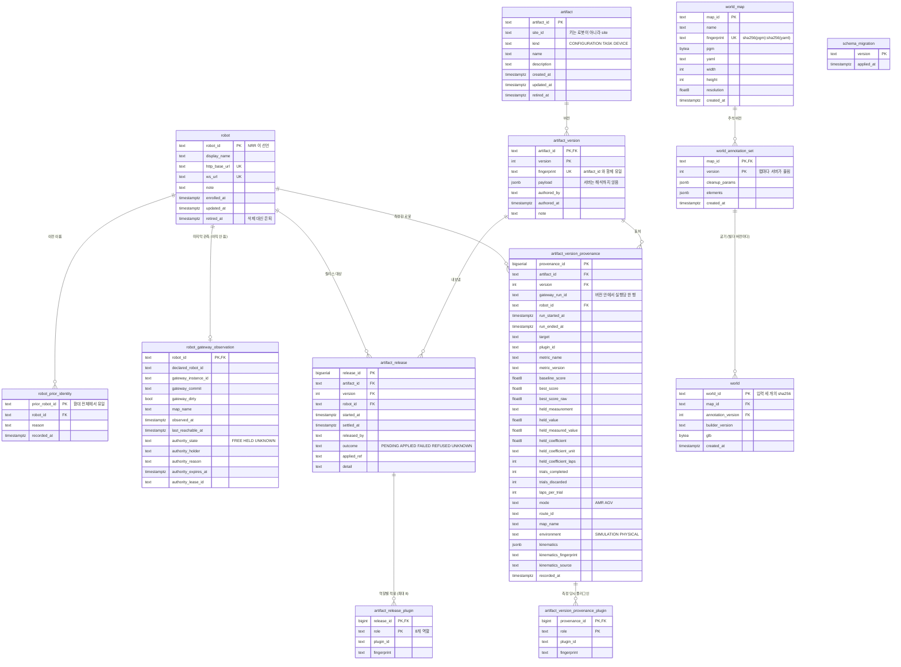

- **지우지 않고 은퇴시킨다.** `robot` 과 `artifact` 는 `retired_at` 으로 은퇴한다. NRR 실행 DB 에는 이 `robot_id` 가 찍힌 주행이 있고, 릴리스는 아티팩트를 참조한다. 지우면 기록이 고아가 된다. 같은 이유로 FK 는 거의 다 `ON DELETE RESTRICT` 다. 부모 없이는 의미가 없는 `artifact_release_plugin` 과 `artifact_version_provenance_plugin` 만 `CASCADE` 다.
- **ID 는 RES 가 발급하지 않는다.** `robot_id` 는 NRR 이 선언하고 RES 는 관측 · 검증만 한다. 형식은 소문자 · 숫자 · 하이픈(`^[a-z0-9]+(-[a-z0-9]+)*$`)이고 CHECK 로 강제한다. 화면에 보이는 이름(`display_name`)은 RES 것이다. 이름을 바꾸는 일이 NRR 설정 변경이 되면 안 된다.
- **이전 이름은 별도 테이블이다.** `prior_robot_id` 가 PK 라서 한 이름은 함대 전체에서 한 로봇만 가질 수 있다. 배열 컬럼으로는 이 함대 전역 제약을 걸 수 없다.
- **두 주소가 모두 UNIQUE 다.** 한 호스트에서 로봇을 포트로 나누면, WebSocket 포트만 틀린 등록이 한 로봇의 포즈를 두 카드에 그린다. 매끄럽고 멀쩡해 보이게. 서버의 신원 확인은 HTTP 로 묻기 때문에 이 실수를 못 잡는다. 스키마만 잡을 수 있어서 `ws_url` 에도 UNIQUE 를 걸었다(0003).
- **내용 주소.** `artifact_version.fingerprint`(키를 정렬한 payload 의 sha256), `world_map.fingerprint`, `world.world_id` 는 내용에서 나온다. 같은 내용은 같은 행이 된다.
- PGM 과 GLB 바이트는 별도 파일 저장소 없이 `BYTEA` 로 넣었다.
- `artifact_version.payload` 는 서버가 해석하지 않는다. 모양은 그것을 만드는 작업 화면의 것이고, 서버에서 두 번째로 정의하면 언젠가 어긋난다.
- RES 가 읽기만 하는 NRR 실행 DB 는 RES 소유가 아니라서 이 그림에 넣지 않았다. 읽는 테이블은 `navigation`, `navigation_execution_plugin`, `navigation_plugin_configuration` 셋이다.

## DFD

### 레벨 0

시스템 하나(RES = 화면 + 서버)와 바깥의 것들이다. 로봇과 시뮬레이터는 NRR 뒤에 있고 RES 가 직접 닿지 않는다.

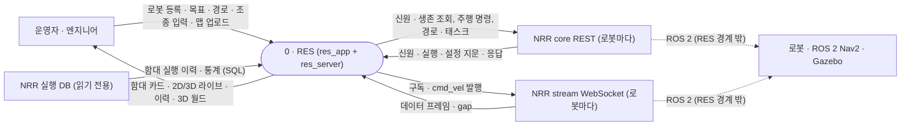

### 레벨 1 — 서버

서버 프로세스 일곱 개와 저장소 하나다. 화면(res_app)은 시스템 안쪽이라 프로세스로 그렸다. 탐색과 아티팩트는 화면이 없어서 API 를 직접 부르는 사람을 따로 그렸다.

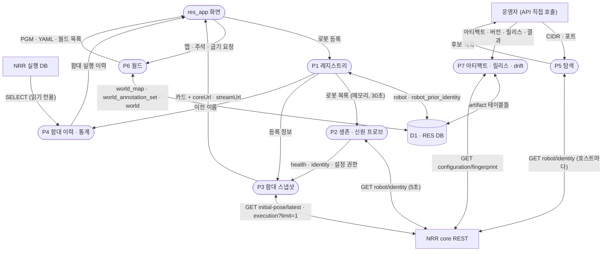

### 레벨 1 — 화면

주행과 라이브 데이터는 RES 서버를 거치지 않는다. 화면이 NRR 에 직접 붙는다.

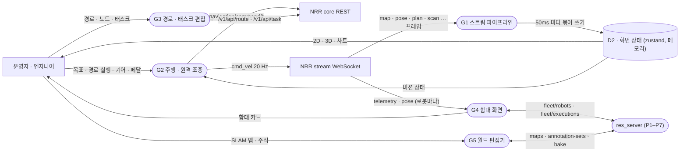

## 시나리오

### 1. 로봇 등록과 신원 확정

로봇은 사람이 등록한다. 하지만 등록은 "이렇게 믿는다"는 기록일 뿐, 그것이 사실이라는 뜻은 아니다. 서버는 등록된 주소로 5초마다 NRR 에게 누구냐고 묻고, 함대 전체를 놓고 신원을 판정한다. 주소를 모를 때 쓰는 네트워크 탐색은 후보만 내놓는다. 탐색은 화면이 없고 API 로만 부른다.

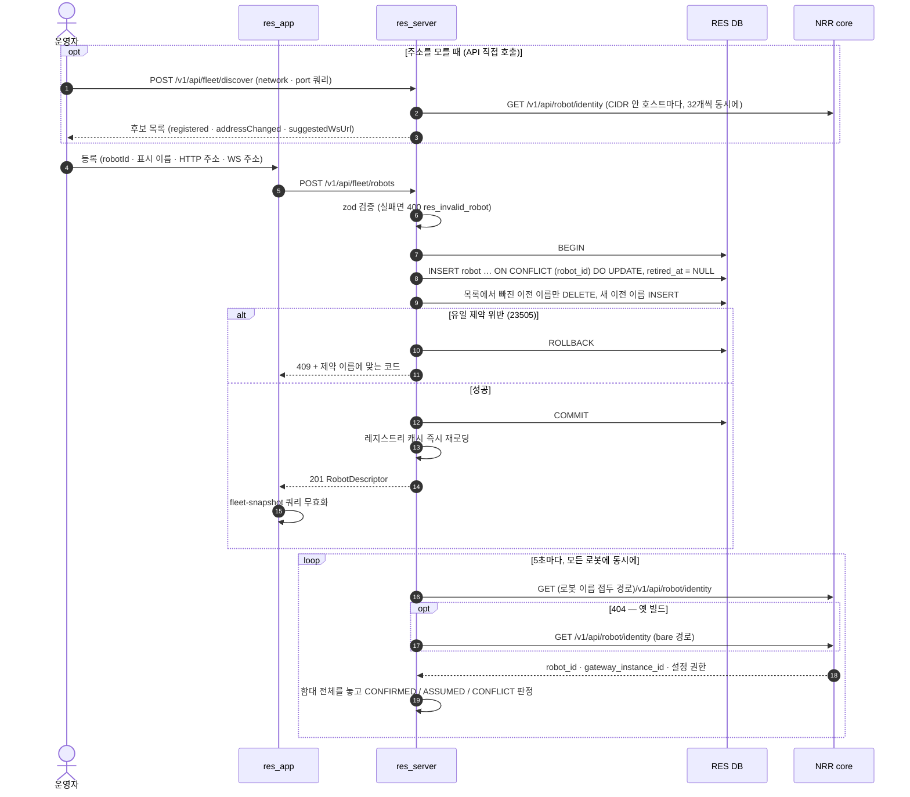

409 코드는 제약 이름으로 고른다: `res_robot_already_registered`, `res_http_base_url_already_registered`, `res_ws_url_already_registered`, `res_prior_name_belongs_to_another_robot`.

**왜 이렇게 했나**

- **ID 는 NRR 이 선언하고 RES 는 검증만 한다.** RES 가 ID 를 따로 발급하면 신원 공간이 둘이 되고 그 사이에 대응표가 생긴다. 대응표는 반드시 썩는다. 주소도 신원이 아니다. IP 는 바뀐다. 주소는 찾아가는 방법이지 누구인지가 아니다.
- **upsert 는 한 트랜잭션이다.** 이전 이름이 반만 붙은 로봇은 이력이 반만 붙은 로봇이고, 신원 판정은 그것을 충돌로 본다. 남아 있는 이전 이름은 지웠다 다시 쓰지 않는다. `recorded_at`("언제부터 그 이름을 안 썼나")은 신원이 이상해 보일 때 바로 묻는 값이라, 주소 하나 고쳤다고 바뀌면 안 된다.
- **등록 직후 캐시를 바로 다시 읽는다.** 30초 뒤에야 나타나는 카드는 등록이 실패한 것처럼 읽힌다.
- **신원은 함대 단위로 판정한다.** 두 NRR 이 같은 이름을 주장하면 각자는 멀쩡해 보인다. 둘을 같이 봐야 드러난다. 그래서 중복이면 양쪽 모두, 등록과 일치하는 쪽까지 CONFLICT 로 둔다. 사유는 `duplicate_declaration` → `stale_identity`(이전 이름을 선언) → `declared_mismatch` 순으로 앞선다.
- **생존은 폴링으로 본다.** 가장 중요한 실패, 곧 로봇 PC 가 통째로 꺼진 경우는 아무 메시지도 만들지 않는다. 응답이 없다는 사실로만 드러난다. HTTP 상태 코드가 하나라도 오면(404 도) 프로세스는 살아 있는 것이다. 아무 응답이 없을 때만 실패로 세고, 연속 2번이 돼야 OFFLINE 이다. 깜빡이는 카드는 아무도 믿지 않는다.
- **경로 모양은 NRR 빌드마다 다르다.** 로봇 이름을 경로에 넣는 새 빌드와 그렇지 않은 옛 빌드가 섞여 있다. 서버가 프로브하면서 어느 쪽인지 알아 두고, `gateway_instance_id` 가 바뀌면(프로세스가 바뀌면 빌드도 바뀌었을 수 있다) 그 기억을 버린다.
- **탐색은 요청이 올 때만, 좁은 범위만 돈다.** 주기적인 네트워크 스캔은 보안 쪽과 해마다 다퉈야 하는 일이고, 로봇을 추가하는 일은 드물다. 범위는 /22–/30 으로 묶었다(README 의 측정: 호스트 254개에 3.2초, 1022개에 12.9초). 그리고 사람이 등록해야만 함대에 들어간다. 옆자리에서 켠 시뮬레이터가 저절로 들어와 함대 통계에 섞이면 안 된다.

### 2. 함대 홈 — 스냅샷과 활동 피드

`/home` 런처는 5초마다 함대 스냅샷 한 번으로 모든 카드를 그린다. 포즈 · 속도처럼 초 단위로 바뀌는 값은 스냅샷에 없다. 화면이 로봇마다 NRR stream 에 직접 붙어서 받는다. 최근 활동은 10초마다 RES 서버가 NRR 실행 DB 에서 읽어 준다.

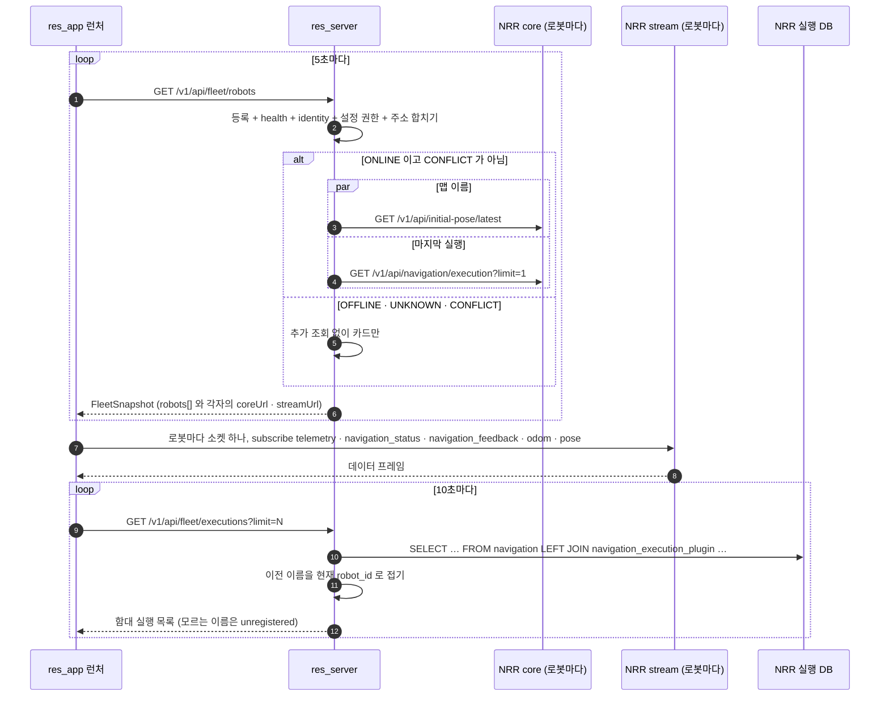

**왜 이렇게 했나**

- **주소는 서버가 완성해 준다.** NRR 빌드마다 경로 모양이 다른데, 화면이 그것을 알 필요가 없다. 스냅샷에 실린 `coreUrl` · `streamUrl` 을 그대로 쓴다.
- **꺼진 카드와 충돌 카드에는 더 묻지 않는다.** 꺼진 로봇에 물으면 필드마다 타임아웃 하나를 살 뿐이다. 신원 충돌 카드는 그 NRR 이 말하는 것을 이 로봇 것으로 돌리지 않는다. 충돌이 풀릴 때까지 그 카드에는 충돌 사실만 남는다. 엉뚱한 데이터가 집계로 흘러가지 않게 하는 장치이기도 하다.
- **라이브 값은 중계하지 않는다.** NRR stream 이 이미 여러 클라이언트에 나눠 준다. 서버를 한 번 더 거치면 뒤처질 수 있는 홉만 는다.
- **함대 이력은 SQL 한 번이다.** 로봇마다 HTTP 를 부르지 않는다. 그래서 꺼진 로봇도 자기 이력에 남고, 로봇이 늘면 왕복이 아니라 행이 는다. 이름이 바뀐 로봇의 옛 기록은 현재 이름으로 접고, 레지스트리가 모르는 이름은 버리지 않고 표시한다. 등록 안 된 로봇이거나 신원 사고이고, 둘 다 들여다볼 일이다.
- **설정 권한은 공짜로 읽는다.** 누가 설정을 잡고 있는지(FREE · HELD · UNKNOWN)는 5초 신원 응답에 같이 실려 오므로 추가 호출이 없다. UNKNOWN 은 FREE 가 아니다. 읽을 수 있는 답이 없었다는 뜻이다. 알려 주는 용도이고 막는 용도는 아니다.
- **카드는 신원 충돌을 건강 색보다 먼저 보인다.** 연결은 멀쩡한데 신원이 틀린 로봇이 가장 위험하다. 초록 카드로 보이면서 남의 이력에 데이터를 쌓기 때문이다.

### 3. 로봇 워크스페이스 진입 — 스트림과 신원 게이트

로봇을 고르면 `/robot/:robotId` 워크스페이스가 열린다. 여기서부터 RES 서버는 경로에 없다. 화면은 스냅샷에서 받은 주소로 NRR 에 직접 붙고, 스트림에서 신원을 한 번 더 확인한다. 두 일이 나란히 돈다. 소켓은 스냅샷에 등록된 ID 를 기대하고, 따로 부르는 신원 조회는 명령 본문에 실을 `robot_id` 를 NRR 에서 받아 온다.

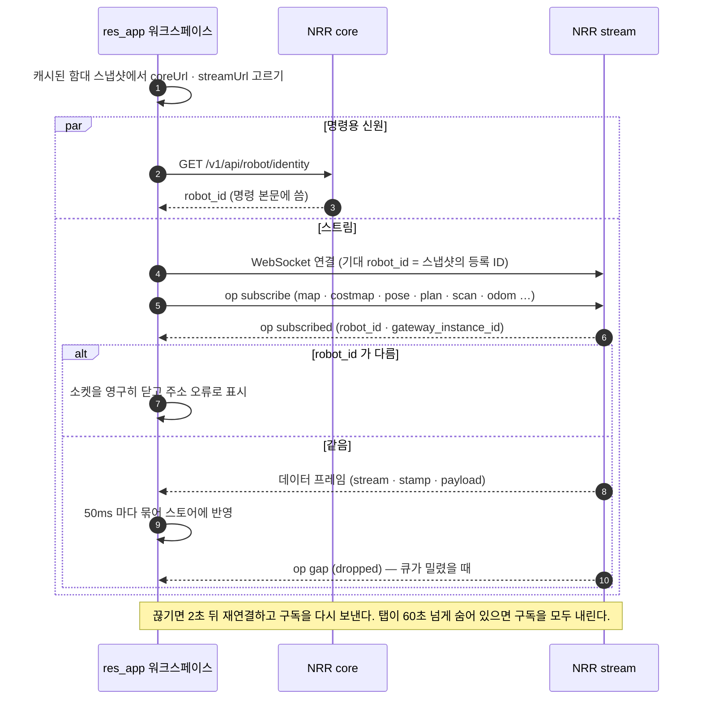

**왜 이렇게 했나**

- **스트림에서 신원을 다시 본다.** 서버의 신원 확인은 HTTP 로 묻기 때문에 WebSocket 주소만 틀린 경우는 못 잡는다. 그래서 `subscribed` 응답의 `robot_id` 를 화면이 다시 대조한다. 다르면 재시도해도 답이 바뀌지 않으므로 소켓을 영구히 닫는다. 프레임마다 실린 `robot_id` 도 한 곳에서 비교해, 남의 프레임은 스토어에 닿기 전에 버린다.
- **`gateway_instance_id` 는 NRR 프로세스를 가리킨다.** 재연결 뒤 값이 바뀌었으면 NRR 이 재시작한 것이다. 화면은 그 로봇의 세션 상태(진행 중인 미션 표시 등)를 내려놓는다.

### 4. 미션 — AMR 목표 · AGV 경로 실행

AMR 은 지도 위 목표 좌표로, AGV 는 저장된 경로 ID 로 달린다. 명령은 화면이 NRR core 에 직접 보내고, 상태 확정은 NRR stream 의 `navigation_status` 로 받는다. RES 서버는 이 흐름에 없다. 경로 저장(`POST · PATCH /v1/api/route`)은 빌드 플래그 뒤에 있고 기본 빌드에서는 stub 이다. 목록 · 상세 · 삭제 · preset 은 플래그 없이 부른다.

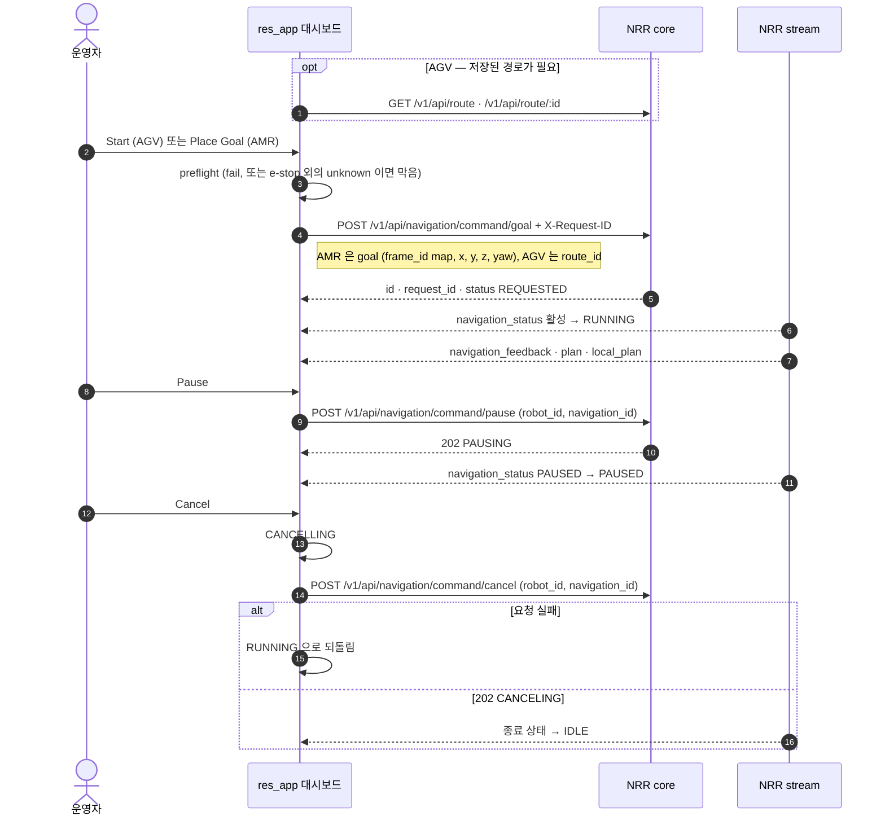

**왜 이렇게 했나**

- **명령은 NRR 에 직접 간다.** 위 "관리 평면과 제어 평면"의 결정 그대로다.
- **Pause · Resume 은 클릭이 아니라 로봇이 확정한다.** 202 는 "받았다"(PAUSING)일 뿐이다. 실제 PAUSED 는 스트림이 말한다. NRR 이 거절하면 버튼은 그대로 Pause 로 남는데, 그게 사실이다.
- **Cancel 은 한 번 클릭이다.** 이미 움직이는 주행을 멈추는 버튼이 2초 동안 동의를 기다리는 건 맞지 않는 모양이다. 누르는 즉시 CANCELLING 으로 들어가고, 요청이 실패하면 원래 상태로 되돌리고, 종료는 스트림으로 확정한다.
- **명령 본문은 robot_id 와 식별자 하나뿐이다.** NRR 이 모르는 필드를 거절하기 때문이다. `navigation_id` 를 먼저 쓰고, 400 이면 화면이 직접 보낸 `request_id` 로 한 번 더 보낸다.
- **시작 버튼과 BLOCKED 배지는 같은 규칙 하나를 쓴다.** 둘이 로봇이 움직여도 되는지를 다르게 말하는 일이 없다.

### 5. 원격 조종 — cmd_vel 과 미션 잠금

원격 조종 화면은 운전대 · 페달 · P/R/N/D 기어로 `cmd_vel` 을 NRR stream 에 직접 발행한다. 여기도 RES 서버는 관여하지 않는다.

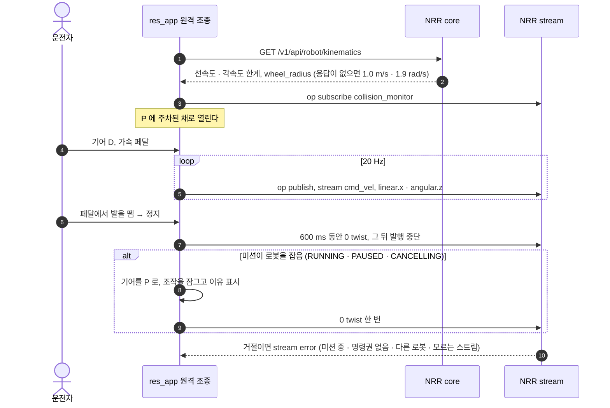

**왜 이렇게 했나**

- **기어가 곧 게이트다.** ARM 토글은 없다. P 는 어느 속도에서나 들어가는 주차 브레이크이고, 후진 중의 D 와 전진 중의 R 은 거절한다. 이 인터록은 CSS 가 아니라 순수 모델 안에 있다.
- **멈춘 뒤 600 ms 만 0 을 보내고 조용해진다.** 열어 둔 탭이 20 Hz 로 0 을 계속 보내며 다른 발행자와 싸운 일이 있었다(코드 주석, 2026-09-15). 그 뒤의 정지는 NRR 쪽 500 ms deadman 이 맡는다고 코드 주석에 적혀 있다. NRR 쪽 동작이라 RES 코드로는 검증하지 않았다.
- **미션이 끝나도 P 에 그대로 둔다.** 잠금은 풀리지만, 다시 움직이려면 운전자가 직접 기어를 넣어야 한다. 조작권은 돌려주되 떠밀지 않는다.
- **성공 ack 는 없다.** 거절만 stream error 로 온다.

### 6. SLAM 맵 → 3D 월드 굽기

편집기에서 SLAM 맵(PGM + YAML)을 정리하고 벽 · 물체 · 가상 벽에 높이를 붙이면 서버가 3D 월드(.glb)로 굽는다. 같은 `@res/world-builder` 패키지가 브라우저(미리보기)와 서버(굽기)에서 돈다.

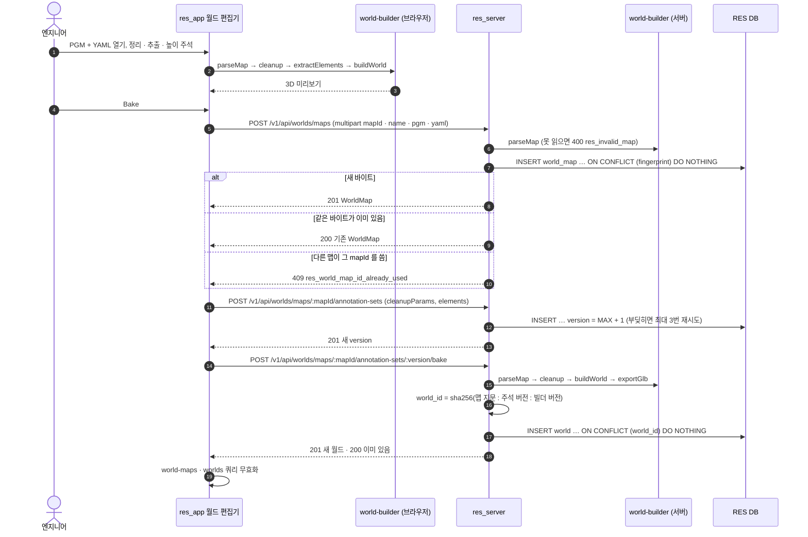

**왜 이렇게 했나**

- **테이블이 셋인 건 수명이 셋이라서다.** 맵은 바뀌지 않는 바이트다. 주석은 사람이 만든 작업이라 버전이 오른다. 월드는 둘에서 결정적으로 구운 결과라 언제든 다시 만들 수 있다. 제자리 UPDATE 는 없다. 고칠 일은 새 버전이 된다.
- **업로드는 내용 주소다.** 같은 바이트를 다시 올리면 처음 받은 ID 의 맵을 200 으로 돌려준다. 같은 ID 에 다른 바이트면 409 다.
- **주석 세트는 정리 파라미터를 같이 저장한다.** 주석이 붙는 덩어리는 그 파라미터에서만 존재하기 때문이다. 버전은 맵마다 서버가 매긴다. 동시에 저장해 같은 번호로 부딪히면, 잘못한 게 없는 사람에게 오류를 보이는 대신 다음 번호로 다시 시도한다.
- **world_id 에 빌더 버전을 넣었다.** 휴리스틱이 바뀐 빌더는 기존 월드를 덮지 않고 다른 월드를 만들어야 한다. 세 입력이 같으면 같은 glb 이므로 굽기는 멱등이다.
- **미리보기와 굽기가 같은 코드다.** 화면에서 본 것이 그대로 구워진다.
- **아직 이어지지 않은 곳.** 서버는 `GET /v1/api/worlds/:worldId/model.glb` 로 glb 를 내주지만, 화면은 아직 이 glb 를 불러오지 않는다. 로봇 대시보드의 3D 뷰는 NRR 이 내주는 Gazebo 씬을 쓴다.

### 7. 설정 아티팩트 → 릴리스 → drift

설정 · 태스크 · 장치 아티팩트를 버전으로 남기고, 어느 로봇에 내보냈는지 기록하고, 로봇이 아직 그것으로 돌고 있는지(drift) 묻는 API 다. 서버와 지문 · drift 단위 테스트, Bruno 요청까지 만들었다. 화면 연결은 제안 단계라 GUI 화면은 없다.

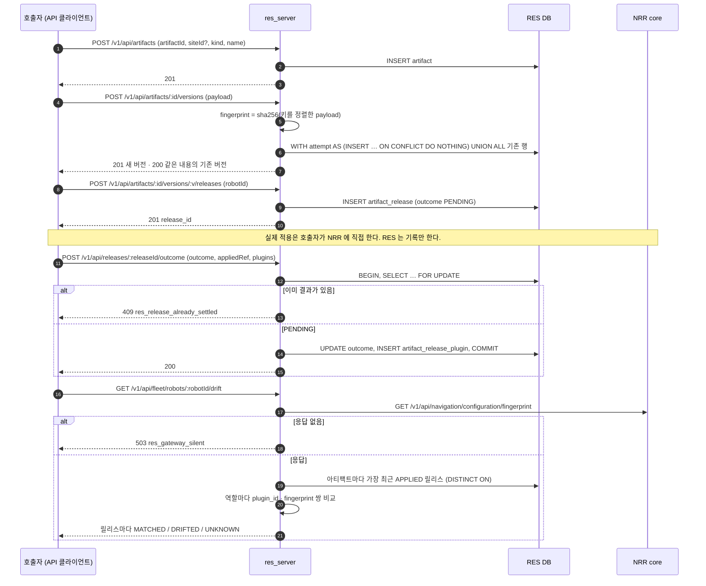

**왜 이렇게 했나**

- **이 서비스가 있는 이유는 한 문장이다.** 무엇을 만들었고, 무엇을 내보냈고, 로봇이 아직 그것으로 돌고 있는가. 세 번째가 없으면 파일 서버다.
- **아티팩트의 키는 로봇이 아니라 site 다.** 로봇으로 키를 잡으면 세 대에 내보낼 때 세 벌을 복사해야 하고, 복사본은 어긋난다. 로봇은 릴리스에만 나온다. 로봇 하나에 한 행이다. 세 대 중 한 대 실패는 흔한 결과인데, 대상 목록을 든 한 행으로는 그걸 말할 수 없다.
- **버전은 내용 주소다.** 바뀌지 않은 내용을 저장하면 번호를 새로 만들지 않고 기존 버전을 돌려준다. v1 의 내용으로 되돌리면 그건 v1 이다. SQL 한 문장으로 처리해서, 두 사람이 같은 순간에 같은 내용을 저장해도 버전이 둘로 갈라지지 않는다.
- **NRR 이 이미 아는 값은 복사하지 않는다.** 릴리스는 적용된 payload 대신, NRR 이 그것을 부르는 이름(`applied_ref`)만 적는다. 사본을 뜨면 그 순간부터 두 값이 갈라진다.
- **릴리스는 NRR 을 부르기 전에 PENDING 으로 쓴다.** 호출자가 중간에 죽어도 보이는 행이 남는다. 잃어버린 사건이 모르는 사건보다 나쁘다. 모르는 사건은 들여다보라고 요구한다.
- **REFUSED 와 FAILED 를 나눴다.** 호출자가 알고 싶은 건 "다시 눌러도 안전한가"다. REFUSED 는 NRR 이 쓰기 전에 거절해서 로봇에 아무것도 안 바뀌었다는 뜻이다. FAILED 는 로봇 상태를 모른다는 뜻이다. 먼저 지문을 읽어야 한다.
- **결과 보고는 한 번만 받는다.** 두 번째 보고를 합치면 이력이 어느 재시도가 마지막에 도착했느냐에 따라 달라진다. 다시 하려면 새 릴리스를 연다.
- **drift 는 역할마다 (plugin_id, fingerprint) 쌍으로 본다.** 지문만 보면, 로봇이 다른 플러그인으로 바꿨을 때 원래 플러그인의 지문은 그대로라 "같다"는 거짓 답이 나온다. 그리고 릴리스가 건드린 역할만 본다. 남이 다른 역할을 바꾼 걸 drift 로 알리면 아무도 그 경보를 읽지 않게 된다. 비교한 역할이 하나도 없으면 MATCHED 가 아니라 UNKNOWN 이다.
- **출처(provenance)는 payload 밖에 둔다.** parameter auto-tuning 결과가 일반 CONFIGURATION 버전으로 들어올 때, 어떤 실행 · 지표 · 로봇 · 환경에서 나온 값인지는 서버가 읽어야 하는 값이다. 해석하지 않기로 한 payload 안에 둘 수 없다. 같은 값에 도달한 두 실행은 충돌이 아니라 증거라서 한 버전에 여러 행을 허용한다.

## 오류와 상태 처리

### 오류 응답은 한 모양

- 모든 오류는 전역 필터 하나(`@Catch()`)를 지나 같은 모양으로 나간다: `{ error, message, detail, source, request_id }`.
- `error` 는 카탈로그의 코드다. 모두 36개다. NRR 과 철자를 맞춘 접두 없는 공용 코드 5개(`not_found`, `method_not_allowed`, `invalid_request_body`, `invalid_parameter`, `internal_error`)와 RES 전용 `res_` 코드 31개. 코드만 보고 어느 서버에 물어야 할지 알 수 있다.
- 상태 코드 · 고정 문구 · `source` 는 카탈로그가 갖고, 호출 지점은 코드와 그 경우에만 참인 `detail` 만 갖는다. 카탈로그에 없는 코드는 타입 오류라 컴파일되지 않는다.
- `source` 는 어디를 들여다봐야 하는지를 말한다: 요청, RES 자신, NRR, 로봇, 인프라. 둘 다 503 인 `res_gateway_silent`(NRR 이 응답하지 않음)와 `res_gateway_database_unavailable`(NRR 실행 DB 에 닿지 못함)을 화면이 구분할 수 있는 건 이 필드 덕분이다.
- Postgres 유일 · FK 위반(23505 · 23503)은 제약 이름을 보고 카탈로그 코드로 바꾼다. 예상하지 못한 제약도 500 이 아니라 카탈로그 코드 하나로 답하고, 제약 이름을 `detail` 에 싣는다.
- 처리하지 못한 예외는 `500 internal_error` 와 `request_id` 만 돌려준다. 스택은 같은 `request_id` 를 붙여 로그에만 남긴다.
- Nest 가 스스로 낸 오류(없는 경로, 읽을 수 없는 본문)도 같은 모양으로 바꾼다. 그대로 두면 `error` 필드에 "Not Found" 같은 HTTP 문구가 들어가 코드처럼 보이지만 어떤 코드와도 일치하지 않는다.
- 문구는 영어다. 화면은 코드로 분기해 운영자용 문구를 따로 쓰고, 서버 문구는 모르는 코드일 때의 대비책이다.

### 서버가 다루는 상태

| 대상 | 값 | 규칙 |
| --- | --- | --- |
| health | ONLINE · OFFLINE · UNKNOWN | HTTP 응답이 오면 ONLINE. 아무 응답이 없는 프로브가 연속 2번이면 OFFLINE, 그 전에는 직전 판정 유지. 계약에 있는 DEGRADED · INOPERATIVE 는 아직 만들지 않는다 |
| identity | CONFIRMED · ASSUMED · CONFLICT | 선언 = 등록이면 CONFIRMED, 선언이 없으면 ASSUMED, 그 밖은 CONFLICT. CONFLICT 카드에는 어떤 데이터도 귀속시키지 않는다 |
| 설정 권한 | FREE · HELD · UNKNOWN | 응답한 마지막 프로브 기준. 응답은 왔지만 신원을 읽을 수 없으면 UNKNOWN, 아무 응답이 없는 프로브는 직전 값을 그대로 둔다. UNKNOWN 은 FREE 가 아니다 |
| 릴리스 결과 | PENDING · APPLIED · FAILED · REFUSED · UNKNOWN | 아래 그림 |
| drift (역할) | MATCHED · PLUGIN_CHANGED · PARAMETERS_CHANGED · UNAVAILABLE | 릴리스 단위로는 바뀐 역할이 하나라도 있으면 DRIFTED, 바뀐 역할 없이 못 읽은 역할이 있거나 비교한 역할이 없으면 UNKNOWN, 그 밖은 MATCHED |

릴리스 결과는 한 번만 확정된다. `(outcome = PENDING) = (settled_at IS NULL)` 과 "REFUSED 면 `applied_ref` 가 없다"는 규칙은 CHECK 제약으로 스키마에 있다.

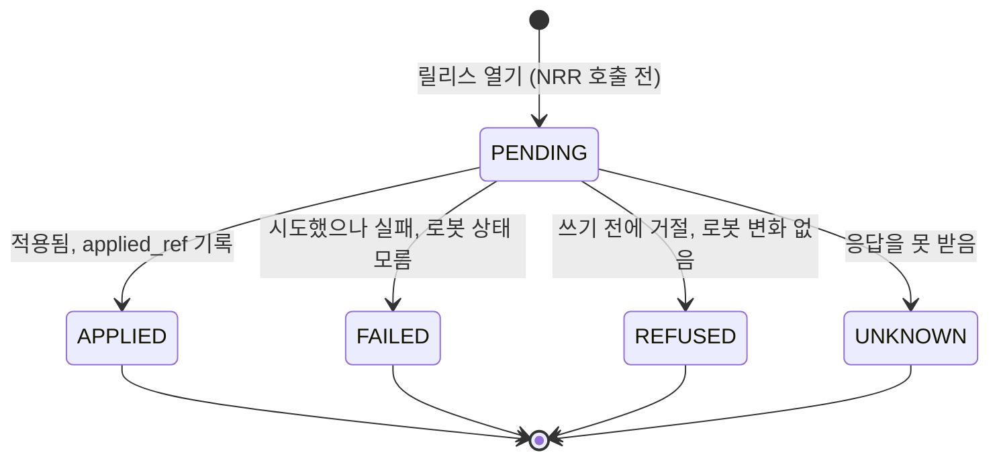

### 실패 모드

- **RES DB.** 부팅 때 레지스트리를 못 읽으면 시작하지 않는다. 빈 함대를 내보내면 꺼진 함대와 똑같아 보이기 때문이다. 주기적인 재로딩이 실패하면 직전 답을 유지한다.
- **NRR 실행 DB.** 읽기 계정이 설정돼 있지 않으면 함대 이력 · 통계만 `503 res_gateway_database_unavailable` 로 답하고 나머지는 돈다. 통계 계정 하나 때문에 서버 전체가 안 뜨는 것보다 낫다. 연결은 권한 자체가 SELECT 뿐인 계정에, 세션에도 `default_transaction_read_only=on` 과 statement timeout 을 건다.
- **NRR.** 응답이 없으면 카드는 OFFLINE 으로 남고 추가 조회를 하지 않는다. drift 같은 단건 질의는 `503 res_gateway_silent` 다. 프로브는 모든 로봇에 동시에 보낸다. 꺼진 로봇 하나의 타임아웃(2초)이 다른 로봇의 보고를 늦추지 않게.
- **환경 변수.** 부팅 때 검증에 실패하면 한 줄 오류를 남기고 종료 코드 1 로 끝난다.

### 화면 쪽 (상태 · 예외 명세 요약)

`docs/06` 상태 · 예외 명세는 화면 쪽 상태를 정리한 문서다. 코드가 문서보다 앞선 곳은 코드를 따랐다.

- **스트림 연결.** `idle → connecting → connected`, 끊기면 `closed` 또는 `error`. 2초 뒤 재연결하고 구독을 다시 보낸다. 마지막으로 받은 데이터는 지우지 않는다.
- **preflight 는 세 상태다.** ok · fail · unknown. fail 은 빨강, unknown 은 주황으로 관측된 고장과 관측 불가를 나눈다. 문서는 unknown e-stop 도 시작을 막는다고 적었지만, 코드는 막지 않기로 결정했다. 지금 NRR 이 e-stop 상태를 내보내지 않아서, 막으면 영원히 출발할 수 없기 때문이다. 패널에는 `N/A` 로 남겨 빈틈이 보이게 했고, 위치추정 unknown 은 여전히 막는다.
- **Cancel.** 문서에는 2초 길게 누르기와 로컬 IDLE 복귀(TBD)가 남아 있다. 지금 코드는 시나리오 4 처럼 한 번 클릭하고 스트림으로 확정한다.
- **시뮬레이터 꺼짐.** NRR 이 503 을 주면 빨간 오류가 아니라 조용한 빈 상태("Simulation not running")로 둔다.
- **원칙.** 복구할 수 있는 오류는 초안 · 뷰포트 · 선택을 그대로 둔다. 저장 실패를 성공으로 착각하게 만드는 자동 닫기는 하지 않는다.
- 문서가 TBD 로 남긴 "표준 오류 응답 모양"은 RES 서버 쪽에서는 위의 오류 응답 하나로 정했다.

## 아직 없는 것

- 인증 · 세션.
- 상태 전이 기록(`robot_health_event`)과 알림. 만들 때는 5초마다의 샘플이 아니라 전이만 적기로 했다.
- health 의 DEGRADED · INOPERATIVE, NRR `/healthz` 의 의존성 보고. 응답을 읽는 코드는 있지만 프로브에 연결하지 않아서, 카드의 의존성 목록은 늘 비어 있다("보고 안 됨"이지 "문제없음"이 아니다).
- `robot_gateway_observation` 영속화.
- drift 주기 검사, payload 검증, 승인 절차.
- 아티팩트 · 릴리스 화면, 화면의 glb 로딩.
- `@res/world-builder` 의 빌더 버전 상수가 손으로 맞추는 값이라 패키지 버전과 어긋나 있다. `world_id` 는 그 상수로 계산된다.
- 서버 쪽 parameter auto-tuning 오케스트레이션 (보류).

## 돌아보며

[//]: # "채울 것: 서버 설계에서 잘한 것 / 다시 한다면 바꿀 것 / 배운 것"
