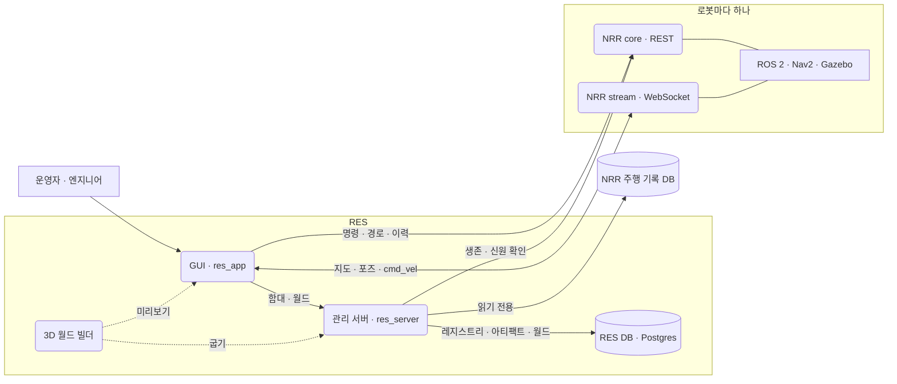

<figure>
<picture>
<source media="(prefers-color-scheme: light)" srcset="/projects/res/dashboard-light.webp">

</picture>
<figcaption>로봇 대시보드 — 경로 주행 중인 로봇. 2D SLAM 지도와 3D 월드를 나란히 놓고, 아래에 텔레메트리 차트 6개. 캡처는 시뮬레이션 로봇으로 찍었고, 로봇 · 월드 이름과 주소 일부는 공개용으로 바꿨다.</figcaption>
</figure>

## 무엇을 위한 도구인가

로봇마다 NRR(Native Robot Runtime)이 하나씩 올라간다. NRR 은 그 로봇을 몰고, 그 로봇의 상태를 책임진다. 로봇 한 대를 보기에는 이것으로 충분하다.

로봇이 여러 대가 되면 NRR 하나로는 답할 수 없는 질문이 생긴다. 어떤 로봇이 있는가. 지금 응답하는가. 우리가 아는 그 로봇이 맞는가. 함대는 지금 어떤 모습인가. RES 는 이 질문에 답하는 곳이다.

화면 구성은 PLC 개발 환경(IDE)을 본떴다. 로봇 한 대가 프로젝트 하나다. 프로젝트를 열면 관제 · 경로 · 이력 · 통계 · 설정 · 튜닝을 한 워크스페이스 안에서 한다.

화면 정의서에 적은 주요 사용자는 운영자, 튜닝 엔지니어, 통합 개발자다.

## 주요 기능

### 함대 런처

등록한 로봇 전체를 한 화면에 보여 준다. 왼쪽은 로봇 목록, 가운데는 고른 로봇의 지도 미리보기(같은 지도에 있는 다른 로봇도 함께), 오른쪽은 그 로봇의 상세 · 주의 목록 · 월드 · 최근 주행이다. 런처는 로봇을 움직이지 않는다.

상태 배지는 순서를 정해 판정한다. 신원 충돌이 건강 상태보다 앞서고, 건강 상태가 스트림 연결보다 앞선다. 스트림이 끊긴 것을 로봇이 죽은 것으로 보지 않는다.

<figure>
<picture>
<source media="(prefers-color-scheme: light)" srcset="/projects/res/launcher-light.webp">

</picture>
<figcaption>함대 런처 — 로봇 7대 가운데 2대가 주행 중이고 3대는 연결이 끊겨 주의 목록에 올라 있다. 가운데 지도에는 고른 로봇과 같은 지도의 다른 로봇이 함께 보인다.</figcaption>
</figure>

### 로봇 워크스페이스

런처에서 로봇을 열면 들어가는 곳이다. 뷰는 일곱 개다.

| 뷰 | 하는 일 |
| --- | --- |
| 대시보드 | 2D SLAM 지도와 3D 시뮬레이션 월드를 나란히 놓고 시운전한다. 초기 위치(수동 · 자동), 목표 지점 주행(AMR), 경로 주행(AGV), 일시정지 · 재개 · 취소. 출발 전 점검은 ok · fail · unknown 세 상태이고, 위치 추정처럼 모르는 값은 통과로 치지 않는다. 2D 지도는 RViz 와 같은 모양으로 그린다. 3D 는 URDF 로봇 모델, 추적 카메라, 같은 지도의 다른 로봇, 카메라 로봇 영상을 함께 보여 준다. 텔레메트리 차트 6개. |
| 원격 운전 | 자동차식 콕핏(운전대 · 페달 · 계기판)이나 조이스틱으로 `cmd_vel` 을 20 Hz 로 보낸다. P · R · N · D 기어가 곧 안전 잠금이다. 후진 중에는 D 가, 전진 중에는 R 이 들어가지 않는다. 미션이 돌고 있으면 조작이 잠기고 이유를 보여 준다. |
| 경로 · 태스크 | 경로 목록, 노드 편집, 노드마다 태스크 지정. 로봇 쪽 저장은 빌드 플래그 뒤에 있고 기본값은 stub 이다. |
| 이력 | 지난 주행을 거르고, 한 건을 자세히 보고, 여러 건을 겹쳐 비교한다. |
| 통계 | 주행을 경로 · 컨트롤러 · 환경 같은 축으로 묶어 측정값의 분포와 순위를 본다. 보고서 · 차트 · A/B 비교 세 모드. |
| 최적화 | 로봇 쪽에서 도는 컨트롤러 파라미터 자동 튜닝을 시작하고, 진행을 스트림으로 따라간다. 수렴 곡선, 시행 표, 재측정, 적용. 적용은 Nav2 재구성이 끝나기를 기다린다. 결론을 먼저 보여 주도록 짰다. |
| 설정 | ROS 2 파라미터 YAML 을 폼과 YAML 두 보기로 고치고, 한 변경 묶음으로 적용한다. 화면은 완성했지만 로봇 쪽 API 가 아직 없어서 기본은 fixture 를 읽는다. |

AGV 모드는 노드로 만든 경로를 따라가고, AMR 모드는 목표 지점까지 스스로 길을 찾는다. 테마는 라이트와 다크 둘이다.

<figure>

<figcaption>원격 운전 콕핏 — 기어(P R N D)가 곧 게이트다. P 에서는 속도 명령이 나가지 않는다.</figcaption>
</figure>

### SLAM 지도로 3D 월드 만들기

SLAM 지도(PGM + YAML)를 올리고, 잡티를 정리하고, 벽 · 물체를 뽑고 가상 벽은 직접 그린 뒤 높이를 붙인다. 그러면 서버가 `.glb` 3D 월드로 굽는다. 주석은 버전으로 쌓인다.

편집기의 3D 미리보기와 서버의 굽기는 같은 패키지(`@res/world-builder`)를 쓴다. 그래서 미리본 것과 구운 것이 같다. 같은 지도 · 주석 버전 · 빌더 버전이면 바이트까지 같은 `.glb` 가 나오고, 월드는 그 내용으로 주소를 갖는다. 지도를 다시 만들어도 주석을 다시 붙이고, 못 붙인 것은 지우지 않고 따로 돌려준다.

<figure>

<figcaption>월드 편집기 — 데모 맵을 2D | 3D 분할로 열고 요소 높이를 확정하는 중(10/33). 확정한 요소는 파랑, 추정 높이는 주황.</figcaption>
</figure>

### 관리 서버

- **함대 레지스트리** — 등록, 수정, 은퇴. 로봇은 지우지 않고 은퇴시킨다.
- **생존 확인** — 5초마다 NRR 에 묻고, 두 번 연속 실패해야 OFFLINE 으로 본다.
- **신원 판정** — 각 로봇이 우리가 아는 그 로봇인지 CONFIRMED · ASSUMED · CONFLICT 로 판정한다.
- **함대 스냅숏** — 한 번의 호출로 로봇마다 완성된 접속 주소를 넘긴다. GUI 는 주소를 조립하지 않는다.
- **함대 주행 이력 · 통계** — NRR 의 주행 기록 DB 를 읽기 전용으로 읽는다.
- **네트워크 탐색** — 후보만 제안한다. 함대에 넣는 것은 사람이 한다.
- **월드** — 지도 업로드, 주석 버전, 굽기, 모델 제공.
- **아티팩트 · 릴리스** — 설정 · 태스크 · 디바이스 아티팩트의 버전 저장(내용이 같으면 같은 버전), 로봇별 릴리스 기록, 로봇의 실제 설정이 마지막 릴리스와 어긋났는지(drift) 판정.

오류는 카탈로그 하나로 모았고, 컨트롤러에서 만든 OpenAPI 문서가 GUI 와의 계약이다.

### 아직 없는 것

- 인증. 닫힌 네트워크를 전제로 했고 나중 단계로 미뤘다.
- 로봇 쪽 설정 API. 경로 저장도 기본은 stub 이다.
- 아티팩트 · 릴리스 화면, 네트워크 탐색 화면. 서버 API 까지만 있다. 아티팩트 · 릴리스는 단위 테스트와 Bruno 요청, 탐색은 주소 범위 단위 테스트뿐이다.
- GUI 가 구운 `.glb` 를 불러오는 일. 대시보드의 3D 는 NRR 이 주는 Gazebo 씬을 그린다.
- 설정 · 태스크 · 디바이스 엔지니어링 워크스페이스와 층 전체를 보는 멀티 로봇 워크스페이스. 정의 페이지만 있다. 쓸 수 없는 조작을 흉내 내지 않으려고 일부러 그렇게 했다.
- 서버 쪽 파라미터 자동 튜닝 관리. 브랜치에서 일부 만들고 보류했다.
- CI.

## 한눈에 보는 구조

- **GUI 가 붙는 서버는 세 종류다.** RES 서버(함대 · 월드), 로봇마다 NRR core(REST)와 NRR stream(WebSocket). 빌드에 들어가는 주소는 RES 서버 하나뿐이고, 로봇 주소는 함대 스냅숏으로 받는다.
- **서버는 관리만 한다.** 로봇을 움직이는 것은 NRR 이다. 서버는 로봇에 명령하지 않고 로봇에 쓰지 않는다. 주행 명령과 실시간 스트림은 GUI 가 NRR 에 직접 붙는다.
- **GUI 는 ROS 에 직접 붙지 않는다.** 처음에는 rosbridge 를 썼고, 2026-08-18 에 NRR stream 으로 바꿨다.
- **상태는 두 군데에 둔다.** REST 응답은 TanStack Query 캐시에, 실시간 스트림은 zustand store 에. React Context 로 상태를 나르는 곳은 없다.
- **저장소.** RES DB(Postgres)에 레지스트리, 아티팩트, 월드를 둔다. 지도 PGM 과 GLB 바이트도 이 DB 에 들어간다. ORM 없이 번호 붙인 SQL 마이그레이션을 쓴다. 주행 기록은 NRR 쪽 DB 에 있고 RES 는 읽기만 한다.

## 플랫폼

`src/` 는 하나이고 플랫폼 분기 코드가 한 줄도 없다. 플랫폼마다 다른 것은 `platforms/` 의 포장만 맡는다. 웹에서 확인한 것이 그대로 모든 플랫폼에 간다.

| 플랫폼 | 포장 | 상태 |
| --- | --- | --- |
| 웹 | Vite 개발 서버, 정적 빌드 | 빌드 · 실행 |
| 데스크톱 | Electron 44 — `app://` 스킴으로 서빙, CORS 헤더가 없는 응답에만 보완, 샌드박스 렌더러 | Linux AppImage · deb 빌드 · 실행 확인. Windows · macOS 는 설정만 |
| Android | Capacitor 8.5 | 디버그 APK 빌드, 에뮬레이터에서 확인 |
| iOS | Capacitor 8.5 | Xcode 프로젝트 생성까지. macOS 가 없어 실행은 못 해 봤다 |

2026-10-26 에 Electron 과 Android 에뮬레이터를 Chrome DevTools Protocol 로 확인했다. 런처의 로봇 목록, 출발 전 점검을 포함한 REST, 딥링크 새로 고침, 2D 지도 실시간 스트림, 3D 텍스처(오류 0)까지 됐다.

서명, 자동 업데이트, CI 는 없다. 서버 주소는 빌드할 때 고정되고, 대시보드는 데스크톱 화면을 기준으로 설계했다.

## 타임라인

| 날짜 | 버전 | 내용 |
| --- | --- | --- |
| 2026-08-10 | GUI 0.1.0 | 더 큰 저장소에서 떼어 단일 로봇 대시보드로 시작 |
| 08-14 | GUI 0.2.0 | 출발 전 점검, 미션 진행 표시 |
| 08-18 | GUI 0.3.0 | rosbridge 를 걷어내고 NRR stream 으로 |
| 08-19 | GUI 0.4.0 | 이력 · 경로 · 설정 화면 |
| 08-21 | GUI 0.5.0 | AGV / AMR 분리, URDF 로봇을 2D · 3D 에 |
| 08-25 | GUI 0.6.0 | 통계 — 순위, 검증, A/B 비교 |
| 08-28 | GUI 0.7.0 | 3D 추적 카메라 |
| 09-01 | GUI 0.8.0 | 취소 · 일시정지 · 재개, 경로 · 태스크 |
| 09-02 | 서버 0.1.0 | 관리 서버 첫 커밋 (이때는 별도 저장소) |
| 09-03 | GUI 0.9.0 · 서버 0.4.0 | `/home` 런처, 로봇 = 프로젝트, 한 지도 위의 전체 로봇 · 서버의 탐색과 생존 확인 |
| 09-04 | GUI 0.10.0 · 서버 0.6.0 | 지금 이름으로 바꿈, 역할 토큰과 라이트 테마 · 아티팩트와 릴리스 |
| 09-09 | GUI 0.11.0 | 최적화 화면 |
| 09-11 | 빌더 0.1.0 → 0.3.1 · 서버 0.9.0 · GUI 0.12.0 | 하루에 월드 빌더, 서버 월드 도메인, 월드 편집기 |
| 09-15 ~ 16 | GUI 0.13.0 · 0.14.0 | 원격 운전 콕핏, 이어서 P · R · N · D 기어와 계기판 |
| 09-28 | GUI 0.15.0 | 보기 설정 저장, glb 메시 |
| 10-13 | GUI 0.16.0 | 최적화 점수 · GP-BO · 수렴 곡선 · 재측정 |
| 10-15 | GUI 0.17.0 | 카메라 로봇 영상을 3D 위에 |
| 10-19 | GUI 0.18.0 | 시뮬레이션 로봇을 시뮬레이터의 참값 위치에 그림 |
| 10-26 | GUI 0.19.0 | 웹 · Electron · Android · iOS 포장, 서버 저장소를 이력째 합침 |
| 10-27 | 서버 0.12.0 | 서버 내부 패키지 다섯 개를 도메인 폴더로 풀어 넣음 |
| 10-29 | — | 마지막 커밋. 이후 작업은 후속 프로젝트로 옮겼다 |

## 규모

마지막 커밋(2026-10-29) 기준으로 센 값이다.

- **커밋** 676개, 커밋한 날 40일 (8월 243 · 9월 355 · 10월 78). 종류별로 feat 268 · fix 237 · docs 70 · refactor 31 · perf 27 · chore 22.
- **패키지** 3개 — `@res/app` 0.19.1, `@res/server` 0.12.0, `@res/world-builder` 0.3.1.
- **GUI** — 화면 라우트 11개(로봇별 뷰 7개 포함)와 계획 단계 정의 페이지 4개, 기능 폴더 19개. 소스 316개 파일 57,664줄, 테스트 163개 파일 27,353줄.
- **서버** — 컨트롤러 8개, 라우트 핸들러 33개, SQL 마이그레이션 10개, 소스 9,131줄, 테스트 파일 17개, Bruno API 요청 48개. 보류한 튜닝 도메인은 뺀 값이다.
- **3D 월드 빌더** — 소스 1,285줄, 테스트 파일 9개, 런타임 의존성 1개(earcut).
- **문서** — 화면 · 기능 · 인터페이스 설계 문서 48편, GUI 구현 문서 20편, 서버 설계 문서 5편.

## 내 역할

혼자 한 프로젝트다. 커밋 작성자는 나 하나다. 무엇을 만들지, 화면이 어떻게 보이고 움직여야 하는지, 서버와 GUI 의 경계를 어디에 둘지를 정했다. 구현은 Claude Code 와 함께 했다. 커밋 676개 가운데 601개에 Claude 공동 작성 표시가 있다. 동작은 Gazebo 시뮬레이션 로봇으로 확인했다.

[//]: # "채울 것: 내가 직접 한 일과 AI 에게 맡긴 일의 경계, 가장 중요했던 설계 판단 한두 개"

## 돌아보며

[//]: # "채울 것: 배운 것, 다시 한다면 다르게 할 것"
